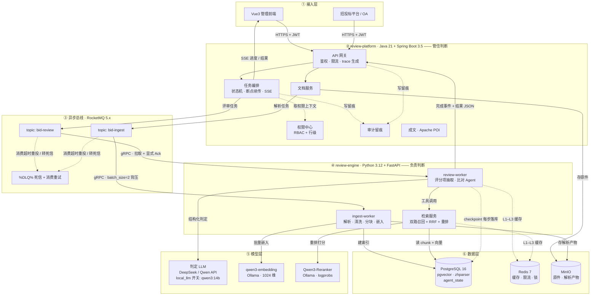
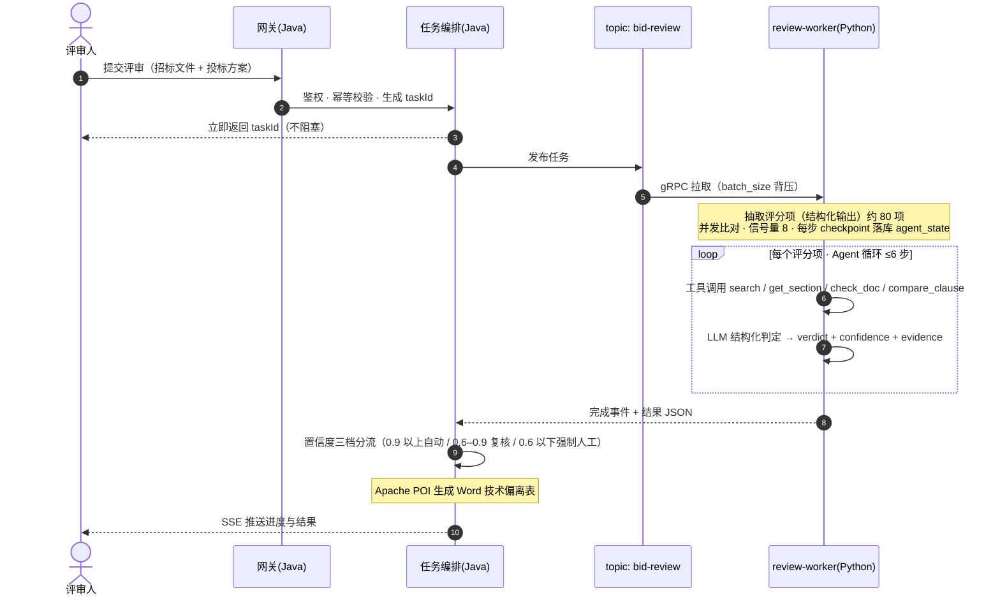

# 招投标技术方案评审系统 · 总体架构设计 v1.0

> **文档定位**：在《从零搭建生产级RAG平台（完整电子书）》的基础上，补全其未覆盖的部分（Agent 编排、消息队列、Java 平台层、双栈边界、本地资源预算），形成可直接落地的系统架构。
> **约束条件**：① 2026 主流技术栈，明确排除过时方案 ② 并发/异步作为核心学习目标 ③ 真实企业级（运维/数据量/扩展路径）④ 模型服务**本地优先**（Ollama 嵌入 + Ollama Qwen3-Reranker 重排，logprobs 打分），判定 LLM 走云端 API，本地中间件须轻量 ⑤ 技术选型兼顾面试价值。

---

## 一、与电子书的对齐关系

电子书直接采纳的部分（不再重复论证）：

| 电子书结论 | 本架构的落点 |
| --- | --- |
| 四层架构 + 离线/在线管道物理分离（第 3 章） | ingest-worker 与 review-worker 彻底分开 |
| 12 组件契约、单点可替换（第 3 章） | Python 引擎内部按 12 组件组织代码 |
| 混合检索 + RRF + 两级重排（第 12/13 章） | PG 全文 + pgvector 双路并发召回（RRF：Reciprocal Rank Fusion，按名次融合两路检索结果，见 03 §5.3） |
| 权限前置：acl 入库 + 数据访问层强制注入（第 25 章） | Java 权限中心 → 检索过滤条件透传，业务代码无法绕过 |
| Agentic 渐进路径：路由→反思→多跳→工具型（第 16 章） | 评分项比对 Agent 按此路径演进，带三护栏 |
| 框架做集成、检索链路自己写、不用一键 RAG（第 3.5 章） | 全程自研：检索链路 + Agent 循环 + checkpoint 都手写，不用 LangChain/LangGraph |
| 评测先行、分层指标（第 19–21 章） | Phase 0 先建 golden set |
| 统一用 MinerU 解析（第 4 章） | 全格式（docx/pdf/doc/zip 内文档）统一走 MinerU：扫描件/图片型用 VLM（视觉大模型）模式，文本型/复杂中文用 pipeline 模式 |
| 按队列积压扩容、降级链（第 22 章） | RocketMQ 消费位点积压为扩容信号 |

电子书没有、本文补全的部分：**自研 Agent 编排（手写循环 + 自研 checkpoint/HITL）、MCP 工具层、消息队列选型、Java 平台层完整设计、双栈 API 契约的工程落地、本地开发机资源预算、容量测算与扩展触发器**。

---

## 二、总体架构图

> **读图约定**：一张图只回答一个问题——2.1 管「分层与协议」，2.2 管「评审主流程」，2.3 管「部署归属」。五个核心数据流的完整文字版在第三节，是这三张图的展开。

### 2.1 系统分层架构（调用关系 + 协议）



**读图要点**：虚线 = 状态写入 / 旁路（审计、缓存、checkpoint），实线 = 业务调用。**同步调用（HTTPS → 网关）与异步消费（gRPC → worker）在边上一目了然**——前者要求立即响应，后者靠队列削峰，这条区别是本架构并发设计的根基。评审过程中的人工追问（延迟敏感）走 `GW → RET` 的同步检索链路，P95 < 3s，不经过队列。

### 2.2 评审任务主流程（时序图）



### 2.3 部署边界（容器 / 宿主机归属）

| 运行位置 | 组件 | 内存 |
| --- | --- | --- |
| **宿主机进程** | review-platform（Java）、review-engine（Python） | ~800MB / ~500MB，便于 IDE 调试 |
| **Docker 容器** | PostgreSQL / Redis / MinIO（RocketMQ 走本机） | ~1.4GB |
| **宿主机进程** | RocketMQ 5.x（NameServer + Broker + Proxy） | ~1.5GB |
| **宿主机或容器** | Ollama（qwen3-embedding + Qwen3-Reranker 常驻） | ~2.5–3GB |
| **可选容器**（Phase 11） | Langfuse、Prometheus / Grafana / Loki | ~2.8GB |

**观测流（一句话说清，不画进架构图）**：Engine → OTel → Langfuse（LLM trace，必含 `terminated_by`）；Platform → Micrometer → Prometheus；日志 → Loki；Grafana 告警盯队列深度 / 429 率 / P95 / 月成本（阈值见第六节）。

**核心边界（延续方案一）**：Python 负责判断（解析/抽取/检索/比对/置信度），Java 负责管住判断（任务/权限/审计/成文/成本）。两侧通过 **RocketMQ（异步任务）+ HTTP REST（同步查询）+ JSON Schema 强契约** 通信。

---

## 三、五个核心数据流

### 流 1：文档入库（离线管道，吞吐优先）

```
上传 docx/pdf → Java 文档服务(MinIO+版本) → MQ:topic bid-ingest
→ ingest-worker: MinerU 解析(扫描件VLM/文本型pipeline) → 清洗 → 结构化分块(带acl/页码/章节号)
→ qwen3-embedding 批量嵌入(Ollama 本地) → 幂等入库(PG: 元数据+向量+全文索引) → 发完成事件
```

- 幂等键（同一个键重复处理只生效一次）：`sha256(文件) + embedding_version + chunking_version`，重复入库自动跳过（电子书 10.2）
- 失败语义：消费超时自动重投、达上限进 %DLQ% 死信、人工介入，**不影响在线链路**

### 流 2：评审任务（异步长任务，本项目的主流程）

```
提交评审(招标文件+投标方案+评分办法) → Java 任务服务生成 taskId(幂等)
→ MQ:topic bid-review → review-worker:
   ① 自研抽取模块: 抽取评分项(结构化输出, Pydantic校验)
   ② 自研比对 Agent: 检索投标方案 → 判定(响应/部分/未响应/负偏离)
   ③ 每项产出 verdict + confidence + evidence(页码/章节/原文) 
   ④ 汇总 → JSON 结论
→ Java 接收 → 置信度三档分流 → Word 偏离表(POI) → SSE 通知前端
```

- 80 个评分项**并发比对**（信号量控制 LLM 并发度，如 8），总耗时从串行 ~40 分钟压到 **5–8 分钟**
- 自研 checkpoint：每步状态落 PG（`agent_state` 表），进程崩溃后从断点恢复，**不重烧已完成的 token**

### 流 3：在线交互（延迟敏感）

评审过程中的人工追问："S3.2.4 这一判定的依据？" → 同步走检索链路（双路并发召回 + RRF + Rerank），P95 < 3s，SSE（服务器向浏览器单向持续推送）流式返回。

### 流 4：人工审批（HITL，受监管动作的闸门）

```
Agent 输出 confidence<0.6 或 PARTIAL → 自研 interrupt（挂起当前项，写 agent_state 标记 pending_human）
→ 状态持久化(PG) → Java 审批队列(带 RBAC) → 专家在前端看证据链
→ 采纳/修改/驳回 → Java 回调 engine → 自研恢复逻辑从 agent_state 读取并继续
```

**这就是自研 checkpointer + interrupt 的标准生产用法**：审批可以发生在数小时后，状态不丢、恢复精确。核心原理与 LangGraph 的 checkpointer 一致——把 Agent 每一步的状态序列化存 PG，支持挂起/恢复/回放——但这里完全手写，理解其底层机制。

### 流 5：观测流

OpenTelemetry 统一埋点（trace_id 从 Java 网关生成、全链路透传）：LLM 调用与 Agent 步骤 → Langfuse；基础设施指标 → Prometheus；日志 → Loki。**每个 trace 必含 `terminated_by`（answer|max_steps|timeout|budget|error）**（电子书 16.5）。

---

## 四、技术选型总表（2026-10 时点）

### 4.1 模型层（本地优先，云可切换 —— 详见 `04-模型服务层部署方案.md`）

| 组件 | 选型 | 理由 | 备选 | 明确淘汰 |
| --- | --- | --- | --- | --- |
| LLM | **DeepSeek-V3 / Qwen-Max**（API） | 结构化输出+工具调用成熟、中文强、价格低（单任务全流程约 ¥1–2）；提供 `local_llm=qwen3:14b` 全内网演示开关 | GLM、Kimi；本地 Ollama qwen3:14b（质量降级） | 本地 CPU 跑判定级 LLM 为常态 |
| 嵌入 | **Ollama 本地部署 `qwen3-embedding:0.6b`**（639MB，1024 维，32K 上下文；指令感知：查询向量可带一段指令文本参与向量化，查询/文档两侧必须一致，见 04 §四） | Ollama 原生 `/api/embed` 批量端点成熟；1024 维与 DDL 零改动兼容；返回已归一化向量直配内积索引；**数据不出内网** | 硅基流动 bge-m3 API（降级/对照） | 本地 sentence-transformers 手写服务（重复造轮子） |
| 重排 | **Ollama 本地部署 `dengcao/Qwen3-Reranker-0.6B:Q8_0`**（用户选定；Q8_0 为 8bit 量化格式，模型体积与精度的均衡档） | 全本地、只维护 Ollama 一套；中文场景效果不弱于 bge-reranker；**用 `/api/generate` + logprobs 还原 yes/no 连续分数**（非原生 /rerank，见 docs/04 §六） | TEI bge-reranker-v2-m3（评测对照）；硅基流动 API（降级兜底） | 用 chat 拿文本二值化（毁掉拒答阈值） |
| 解析 | **统一 MinerU（VLM 模式处理扫描件/图片型，pipeline 模式处理文本型/复杂中文）** | 单解析器覆盖全格式，本地 CPU 可跑（离线管道容忍慢）；扫描件经内置 PaddleOCR 兜底 | MinerU 官方云端 API（加速用） | 仅 pymupdf 硬解（表格/版面丢失） |
| OCR | PaddleOCR（扫描件兜底） | 中文成熟、CPU 可跑 | — | — |

> **模型服务层统一设计**：Provider 抽象（Ollama/TEI/云 API 实现同一接口）+ `rag.yaml` 三行配置切换 + 重排三级降级链。嵌入 provider 是**部署期决策**（换=重嵌入），重排 provider **运行期可切**。隐私分级：嵌入+重排本地化后，出网数据从"整个方案文件"缩小为"评分项+候选段落"；`local_llm` 开关可做零出网演示形态——直接回应招标代理机构"数据不出内网"的真实采购顾虑。

### 4.2 数据层（本地轻量优先）

| 组件 | 选型 | 理由 | 扩容路径 | 明确淘汰 |
| --- | --- | --- | --- | --- |
| 关系+向量+全文 | **PostgreSQL 16 + pgvector + zhparser** | **一库三用**：元数据权威副本 / HNSW 向量 / 中文全文（BM25 替代）——本地只跑一个容器；电子书 8.1：<100 万 chunk 的最低摩擦方案 | >80 万 chunk → **Qdrant**（payload 过滤性能优势，电子书 3.4 栈 B） | Chroma 上生产（原型工具）；ES 起步（本地 1GB+，且与 PG 功能重叠） |
| 缓存/锁/限流 | **Redis 7** | 三级缓存（电子书 24 章）+ Redisson 分布式锁 + 令牌桶 | Redis Cluster | — |
| 对象存储 | **MinIO** | 原件+解析产物，S3 协议 | 云 OSS | 文件存数据库 |
| Agent 状态 | **PG（自研 checkpointer：`agent_state` 表）** | 与业务库同栈，手写状态序列化/挂起/恢复/回放 | 独立 PG 实例 | 内存 checkpointer（重启丢状态） |

### 4.3 异步与通信

| 组件 | 选型 | 理由 | 扩容路径 | 明确淘汰 |
| --- | --- | --- | --- | --- |
| 消息队列 | **RocketMQ 5.x** | 5.x 的 proxy 架构对客户端统一暴露 gRPC，语言无关；Python 走 gRPC 自研客户端（官方 SDK 依赖 C++ 在 Windows 装不上）；概念完整（topic/consumer group/ACK/%DLQ% 死信/消费重试），**练手并掌握 MQ 核心概念 + 国内企业主流技术栈** | 吞吐/日志流 → 同为 RocketMQ（无需再迁移）；需更强路由 → 保留 topic+tag 过滤 | Kafka（重，无 proxy 抽象）；RabbitMQ（已迁移出） |
| 任务队列 | RocketMQ + 自研消费框架（而非 Celery） | 状态机在 Java 侧统一管，Python worker 只做无状态执行；Celery 的调度语义与双栈架构冲突 | — | Celery（把编排权留在 Python 侧，破坏双栈边界） |
| 进度推送 | **SSE**（HTTP/1.1 长连接） | 单向推送足够；Java 21 虚拟线程扛长连接 | WebSocket（仅当需要双向） | 轮询 |
| 内部同步调用 | REST + JSON Schema 契约（Pydantic ↔ Jackson） | 简单、可调试、可替换 | gRPC（吞吐敏感时） | — |

### 4.4 Python 引擎（review-engine）

| 组件 | 选型 | 理由 | 明确淘汰 |
| --- | --- | --- | --- |
| 运行时 | **Python 3.12 + uv + ruff + pytest** | 2026 标准工程链 | pip 手工管理 |
| Web/服务 | **FastAPI + Pydantic v2** | 异步原生、Schema 即文档（电子书 22.2） | Flask（同步） |
| DB 访问 | **asyncpg 原生 pool**（`common/db.py`，2026-10-22 定稿） | 全部 SQL 为手写原生 SQL（向量算子 `<#>` / `SET LOCAL hnsw.ef_search` / JSONB `@>` / advisory lock / zhparser），ORM 表达这些反而隔一层；连接池与语句缓存 asyncpg 原生自带。sqlalchemy 依赖保留（未来 alembic 管迁移再用） | 同步驱动 |
| 检索链路 | **自研**（电子书 3.5：路由/召回/融合/重排/组装自己写） | 可评测、可调优 | LangChain 一键 RAG（`RetrievalQA` 类接口，无法评测） |
| Agent 编排 | **全程手写：自研主循环 + 自研 checkpointer + 自研 interrupt** | 底层理解优先，不引入任何 Agent 编排框架；checkpointer 原理（状态序列化到 PG + 挂起/恢复）完全手写，是核心学习点 | LangChain/LangGraph（违背"底层理解"定位）；CrewAI/AutoGen（角色扮演型，控制粒度不足） |
| 工具层 | **MCP（Model Context Protocol）** | 2026 事实标准（已捐 Linux 基金会）；`search_in_bid` / `get_section` / `check_required_doc` / `compare_clause` 注册为 MCP server，Python 与 Java 双侧可调 | 私有工具协议 |
| LLM 客户端 | **httpx 手写**（OpenAI 兼容接口）+ tenacity 重试 | 底层理解：自己写 HTTP 调用、流式解析、多 provider 简单路由；不引入 litellm 等抽象层 | litellm（隐藏了调用细节，违背底层理解） |
| 埋点 | **OpenTelemetry SDK** | trace_id 全链路透传 | print 日志 |

### 4.5 Java 平台（review-platform）

| 组件 | 选型 | 理由 | 面试价值 |
| --- | --- | --- | --- |
| 运行时 | **JDK 21 LTS + 虚拟线程**（`spring.threads.virtual.enabled=true`） | SSE 长连接/IO 密集场景的自然解法 | ★★★（Loom 是 Java 并发演进主线） |
| 框架 | **Spring Boot 3.5.x**（不含 Spring AI） | Java 侧只做平台层（任务/权限/审计/成文），通过 REST/MQ 调 Python 引擎，**不直接碰 LLM**；符合"Python 负责判断，Java 负责管住判断"的边界 | ★★★（Spring Boot 本身是基础设施，不是 AI 框架） |
| ORM | **MyBatis-Plus** | 国内企业绝对主流，审计/复杂 SQL 友好 | ★★★ |
| 安全 | Spring Security + JWT + 方法级鉴权 | 标准 | ★★ |
| 分布式 | **Redisson**（锁、RRateLimiter） | 限流/防重复解析 | ★★★ |
| MQ 客户端 | RocketMQ 5.x 客户端（gRPC / Spring Cloud Stream 或原生） | ACK 手动、%DLQ% 死信、batch 背压 | ★★★ |
| 文档成文 | **Apache POI（XWPF）** | 偏离表表格/样式/编号控制力 > python-docx | ★★ |
| 观测 | Micrometer + OTel Java Agent | Actuator/Prometheus 自动集成 | ★★ |

### 4.6 观测与运维

| 组件 | 选型 | 备注 |
| --- | --- | --- |
| LLM trace | **Langfuse 自托管**（v3：PG+ClickHouse+Redis，~2GB 内存） | 内存紧张（8GB 机器）→ 换 **Arize Phoenix**（单容器 ~500MB，OTel 原生），二者埋点协议一致可平滑迁移 |
| 指标/日志 | **Prometheus + Grafana + Loki** | 比 ELK 轻一个量级，2026 主流 |
| 告警 | Grafana Alerting | 队列深度、429 率、P95、成本四类核心告警 |

### 4.7 前端

Vue 3 + TypeScript + Element Plus（薄前端，3 个页面：任务管理 / 评审结果与证据链 / 审批工作台）。国内招采系统主流形态，不投入过多精力。

---

## 五、并发与异步设计（12 个必学点，每个都对应面试题）

| # | 学习点 | 本项目的落点 | 面试怎么讲 |
| --- | --- | --- | --- |
| 1 | **异步任务全链路** | 提交→MQ→worker→状态机→SSE 推送，全程无阻塞等待 | "300 页标书评审 8 分钟，用户提交即返回 taskId，页面实时看进度" |
| 2 | **幂等设计** | 任务 ID + 文件 sha256 + 乐观锁；MQ 消费端手动 ACK + 幂等表 | "重复提交/消息重投不会重复烧 token" |
| 3 | **限流（令牌桶）** | Redisson RRateLimiter 对 LLM API 做全局并发闸（如 8 QPS），防 429 | "云端 API 有 RPM 限制，我在消费端做了统一配额而不是散落在代码里" |
| 4 | **并发召回** | `asyncio.gather` 双路（向量+全文）并发而非串行（电子书 22.2：30ms+30ms → ~35ms） | "延迟取决于慢的一路，不是两路之和" |
| 5 | **并发评审** | 80 个评分项信号量并发（8），总耗时 40min → 6min | "吞吐受 LLM 并发度约束而非 CPU" |
| 6 | **断点续传** | 自研 checkpointer（agent_state 表）+ Java 状态机双保险 | "进程崩溃，从第 37 个评分项继续，已花的 token 不重烧" |
| 7 | **背压** | RocketMQ batch_size 拉取上限 + 消费位点积压告警 + 按积压扩容 worker | "流量洪峰不击穿下游 LLM 配额" |
| 8 | **死信与重试** | 消费失败 → invisible 超时自动重投（达上限）→ %DLQ% 死信 → 人工介入 | "失败语义分级：索引可重试，查询必须降级" |
| 9 | **分布式锁** | Redisson 锁"同一文件同时只解析一次"，防并发重复解析 | "锁的粒度是文件哈希，不是全局" |
| 10 | **虚拟线程 vs 线程池** | SSE 长连接用 JDK 21 虚拟线程，对比平台线程的内存占用 | "IO 密集型服务的 Loom 实践" |
| 11 | **连接池** | HikariCP（Java）/ asyncpg pool（Python），启动建池不每请求新建 | "压测时最先死的永远是连接" |
| 12 | **三级缓存** | ①解析结果（MinIO+元数据）②嵌入向量 ③LLM 判定结果（同评分项+同方案版本哈希） | "重复评审/版本比对时 token 成本降 90%" |

---

## 六、容量测算与扩展触发器（企业级的核心：知道什么时候会坏）

### 6.1 初始容量（假设积累 100 个历史项目）

| 项 | 测算 | 结论 |
| --- | --- | --- |
| 单套文档 chunk 数 | 300 页 ≈ 45 万字 ≈ 900 块（512 token/块） | — |
| 总 chunk | 100 项目 × 2 文档 × 900 ≈ **18 万** | pgvector HNSW 舒适区（<100 万） |
| 向量内存 | 18 万 × 1024 维 × 4B ≈ 0.7GB（+索引 2–3 倍 ≈ 2GB） | 单机 PG 可承载 |
| 单任务 token | 80 评分项 × ~3K ≈ 25 万 token | DeepSeek ≈ ¥1–2/任务 |
| 单任务耗时 | 解析 5–10min + 并发比对 5–8min | 用户可接受（异步+SSE） |

### 6.2 扩展触发器（写进 Grafana 告警，也是面试的"容量意识"素材）

| 信号 | 阈值 | 动作 |
| --- | --- | --- |
| chunk 总量 | > 80 万 | PG → **Qdrant**（迁移脚本 + 蓝绿切换，电子书 10.5） |
| 检索 P95 | > 500ms 持续 | PG 读副本 + PgBouncer；`ef_search` 动态下调 |
| 队列深度 | > 100 持续 10min | review-worker 水平扩容（无状态，直接加副本） |
| LLM 429 率 | > 1% | 令牌桶收紧 + 双 provider 路由（DeepSeek↔Qwen） |
| 月成本 | > 预算 80% | 判定缓存命中率提升 + 初筛用小模型分级 |
| 并发 SSE | > 5000 | 虚拟线程天然扛；网关层分流 |

---

## 七、本地资源预算（Docker Compose 服务清单）

| 服务 | 镜像 | 内存预算 | 必须 |
| --- | --- | --- | --- |
| postgres | pgvector/pgvector + zhparser（自建镜像） | 1GB | ✅ |
| redis | redis:7-alpine | 128MB | ✅ |
| rabbitmq | rabbitmq:4-management | 320MB | ✅ |
| minio | minio/minio | 256MB | ✅ |
| ollama | ollama/ollama（qwen3-embedding:0.6b + Qwen3-Reranker-0.6B:Q8_0 常驻） | ~2.5–3GB | ✅（宿主机直跑亦可） |
| langfuse | langfuse + clickhouse 单节点 | 2GB | 可选（8GB 机器换 Phoenix 500MB） |
| prometheus + grafana + loki | 官方镜像 | 800MB | 可选（Phase 11 再上） |
| **合计** | | **~4.5GB（极简）/ ~7.3GB（全量）** | 16GB 开发机无压力；8GB 机器：重排走云 API、观测后置 |

Java（~800MB）与 Python（~500MB）进程跑宿主机，不进容器，便于 IDE 调试。

**生产部署路径**：同一套 Compose 语义平移到 K3s/K8s；worker 按**队列深度**扩容（电子书 22 章：不能按 CPU）；每个 worker 双实例是可用性底线。

---

## 八、目录结构（方案 B：RAG 显式分层）

```
bid-review/
├── review-engine/                 # Python · 负责判断
│   ├── src/
│   │   ├── models/                # ★ 共用 Provider 抽象（rag/agent 都用）
│   │   │   ├── embedding.py  rerank.py  llm.py
│   │   ├── rag/                   # ★ RAG 子系统（显式分层）
│   │   │   ├── offline/           #   离线管道：入库（解析/清洗/分块/嵌入/索引）
│   │   │   │   ├── parsers/  cleaning.py  chunking/
│   │   │   │   ├── embedding.py  indexer.py
│   │   │   └── online/            #   在线链路：检索
│   │   │       ├── retrieve/      #   dense/sparse/fuse（自研）
│   │   │       ├── rerank.py  assemble.py
│   │   ├── agent/                 # ★ 决策层（调用 rag 检索作为工具）
│   │   │   ├── loop.py            #   自研 Agent 主循环（while + 工具分发 + 终止条件）
│   │   │   ├── state.py           #   自研 checkpointer（状态序列化到 PG + 挂起/恢复）
│   │   │   ├── interrupt.py       #   自研 HITL 中断/恢复
│   │   │   └── tools/             #   MCP 工具注册
│   │   ├── workers/               # MQ 消费者（ingest/review）
│   │   ├── api/                   # FastAPI（同步查询接口）
│   │   └── common/                # 配置/日志/trace/DB 连接
│   └── pyproject.toml             # uv 管理
├── review-platform/               # Java · 管住判断
│   └── src/main/java/...
│       ├── task/                   # 状态机·断点续传·SSE
│       ├── authz/                  # RBAC+行级权限
│       ├── audit/                  # 留痕·回放
│       ├── doc/                    # MinIO 文件管理
│       ├── report/                 # POI 偏离表
│       └── integration/            # REST/MQ 对接 Python 引擎（不直接碰 LLM）
├── docs/                           # 架构·评估报告·ADR
├── eval/golden_set.jsonl           # 120 评分项标注（项目根，非 src 内）
├── data/                           # 共享数据（raw/parsed/golden_set）
├── scripts/                        # 采集脚本
└── deploy/
    ├── docker-compose.yaml         # 开发期中间件
    ├── postgres/                   # pgvector+zhparser 自建镜像 + DDL
    └── k8s/                        # 生产期（Phase 11 再填，占位）
```

**依赖方向铁律**：`agent/ → rag/online/ → models/`，`rag/` 不依赖 `agent/`，`models/` 不依赖上层；`common/` 是底层工具，供所有层使用。依赖永远向下。

---

## 九、12 周实施路线（对齐电子书四阶段）

| 周 | 阶段 | 交付物 | 验收（不达标不进下一阶段） |
| --- | --- | --- | --- |
| 1–2 | **数据资产+评估集**（电子书阶段一） | 10–15 套公开招标文件入库；120 评分项 golden set；Compose 环境跑通 | 评测脚本能自动输出判定准确率基线 |
| 3–4 | **RAG 基础**（阶段二） | 离线管道（解析/分块/嵌入/幂等入库）+ 在线检索链路（混合+RRF+Rerank） | Hit@5 ≥ 0.75；双路并发召回延迟 < 100ms |
| 5–6 | **评测与调优** | 分层评测报告；单变量实验记录；拒答与引用校验 | Faithfulness ≥ 0.85；每项优化增益有数据 |
| 7–8 | **Agent 化**（阶段四提前聚焦单场景） | 自研 Agent 循环 + 自研 checkpointer/interrupt；MCP 工具层；三护栏+降级 | 难例（跨章节/附件）准确率提升 ≥5pt；terminated_by 可查 |
| 9–10 | **Java 平台层** | 任务状态机/SSE/RBAC 行级权限/审计/POI 偏离表 | 并发双项目数据隔离测试通过；断点续跑演示 |
| 11 | **生产化** | Langfuse trace、Prometheus 告警、压测报告、降级演练 | MQ 积压压测；LLM 故障不丢任务 |
| 12 | **作品化** | 3 篇博客、README、简历改写 | 面试 5 个高频问题能脱稿答完 |

> 若只有 8 周：砍第 5–6 周的一半（评测做基线+两轮迭代即可）与第 11 周压测，保 Phase 0 与 Java 层。

---

## 十、面试常见问题映射（每项选型都能回答"为什么不用 X"）

| 必问 | 答 |
| --- | --- |
| 为什么 PG 不用 Milvus/ES？ | 18 万 chunk 在 pgvector 舒适区；一库三用降低运维与一致性成本；**我写好了触发器：80 万 chunk 时切 Qdrant，迁移方案是蓝绿索引切换** |
| 为什么 RocketMQ 不用 Kafka？ | RocketMQ 5.x 的 proxy 对客户端统一 gRPC 抽象、概念与国内主流技术栈对齐；Kafka 更偏日志流、无 proxy 抽象，本项目的任务队列语义用 RocketMQ 更贴合 |
| 为什么 Agent 不用 LangGraph/LangChain？ | 本项目定位是**底层理解**——Agent 循环、checkpointer（状态序列化到 PG + 挂起/恢复）、interrupt 全部手写，才能把机制弄明白；用框架会把这些藏在黑盒里。理解机制之后，生产项目再引框架也不迟 |
| 为什么双栈？ | 判断是概率性需迭代，管控是确定性需稳定；换模型不改业务系统 |
| 并发瓶颈在哪？ | 不在 CPU，在 **LLM API 并发配额**——所以限流在消费端统一做，扩展靠 worker 水平扩 + 队列深度信号 |
| 你的 AQ/压测结论？ | 80 评分项并发 8 vs 串行：6min vs 40min；双路并发召回 35ms vs 60ms（自己跑出来的数字） |

---

## 十一、明确排除的过时/不当技术（自检清单）

- ❌ naive RAG（纯向量 top-k 直拼 prompt）
- ❌ Chroma 上生产 / LangChain 一键 RAG / LangGraph / CrewAI / litellm / Spring AI（违背"底层理解"定位，一律不用）
- ❌ 同步阻塞式长任务、轮询代替 SSE、Celery 主导编排
- ❌ 内存 checkpointer、无护栏 Agent、无 terminated_by 的 trace
- ❌ ES 起步（与 PG 全文重叠、本地重）、Kafka 起步（过重）
- ❌ Java 侧自研 RAG 核心（生态弱于 Python，应做集成层）
- ❌ 前端重投入、微服务过度拆分（当前双服务+worker 已够）

---

## 交付物清单（本仓库当前状态）

| 文件 | 内容 |
| --- | --- |
| `docs/01-项目设计与Java经验嵌入方案.md` | 项目定位、双栈边界、置信度契约、8 周计划 v1 |
| `docs/02-系统总体架构与技术选型.md`（本文档） | 总体架构、五数据流、全栈选型、并发 12 学点、容量与扩展、12 周路线 v2 |
