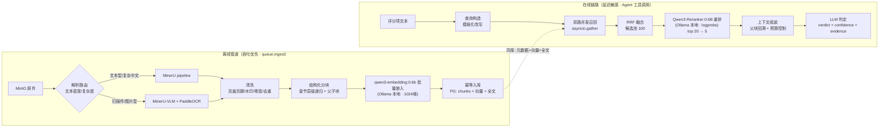

# RAG 子系统详细架构（review-engine · 离线管道 + 在线检索链路）

> **上游文档**：`02-系统总体架构与技术选型.md`（总体架构）、`04-模型服务层部署方案.md`（嵌入/重排本地化与 Provider 抽象）、电子书第 4–14 章（基础参考）。
> **本文职责**：把电子书的通用 RAG 方法，落成"招投标技术方案评审"这一具体场景的组件级设计——含数据模型 DDL、索引参数、管道编排、检索链路每一步的输入输出契约与阈值。
> **逐阶段开发指引**（伪代码级：每行代码的含义、原理、取舍都标注，与本文 §九 实现顺序对应）：[`docs/rag/`](rag/R0-契约与启动自检.md)（R0–R7）。

---

## 一、先想清楚：本项目的 RAG 和通用知识库问答有本质区别

这是整份设计最重要的判断，决定了后面所有参数选择：

| 维度 | 通用知识库问答 | **本项目：评分项比对** |
| --- | --- | --- |
| 查询来源 | 用户自由输入 | **评分项文本（结构化、明确、无歧义）** |
| 查询性质 | 开放式、需要改写理解 | **定向式**："方案里哪里响应了这条要求" |
| 关键词密度 | 低（口语化） | **高**（评分项充满专有名词：达梦 DM8、等保三级、SLA 99.9%、ISO27001） |
| 由此推出 | 向量路为主 | **稀疏路（字面匹配）权重必须高**，型号/编号/标准号差一个字就检索失败 |
| 上下文需求 | 片段即可 | **判定需要完整章节上下文**（"支持国产数据库"必须连着看验证报告、适配清单） |
| 拒答语义 | "知识库没有" | **"方案未响应此要求"——拒答本身就是判定结果**，阈值设计完全不同 |

**另一个关键澄清**：系统里有两条"读长文档"的链路，只有一条是 RAG——

```
链路 A（非 RAG）：评分项抽取
  招标文件 → 章节切分 → LLM 分章节结构化抽取 → scoring_items 表
  （全文都要读，不需要"检索"，是长文档抽取任务）

链路 B（本架构的主角，RAG）：逐项比对
  每个评分项作为查询 → 检索投标方案库 → 重排 → 组装 → LLM 判定 → verdict+confidence+evidence
```

**RAG 知识库的"文档侧"主要是投标技术方案**（+ 可选的历史范本库/公司资质库）；招标文件走链路 A 进结构化表，不进向量库。

---

## 二、RAG 管道总览



横切两个组件：**权限过滤器**（召回前 SQL 强制注入）、**可观测 SDK**（每步埋点：耗时/分数/候选数）。

---

## 三、数据模型（PostgreSQL DDL，直接可用）

### 3.1 documents —— 权威元数据（电子书 3.1：元数据不只放向量库）

```sql
CREATE TABLE documents (
    doc_id          UUID PRIMARY KEY DEFAULT gen_random_uuid(),
    project_id      VARCHAR(64)  NOT NULL,          -- 项目隔离的第一道闸
    doc_type        VARCHAR(32)  NOT NULL,          -- bid_doc | bid_response | reference
    title           TEXT,
    file_sha256     CHAR(64)     NOT NULL,          -- 幂等键
    file_uri        TEXT         NOT NULL,          -- MinIO 路径
    parse_backend   VARCHAR(32),                    -- mineru | mineru-vlm
    parse_quality   SMALLINT,                       -- 0-8 质量分（电子书 4.6）
    acl             JSONB        NOT NULL,          -- ["proj:xxx","sec:标段1","lvl:公开"]
    status          VARCHAR(24)  NOT NULL,          -- uploaded|parsing|indexed|failed|deleted
    embedding_ver   VARCHAR(64)  NOT NULL,          -- qwen3-emb-0.6b@1024@v1@ip@<instr_hash>
    chunking_ver    VARCHAR(32)  NOT NULL,          -- structural_recursive@v1
    created_by      VARCHAR(64),
    created_at      TIMESTAMPTZ  DEFAULT now(),
    UNIQUE (project_id, file_sha256)
);
CREATE INDEX idx_doc_project ON documents(project_id, status);
```

### 3.2 chunks —— chunk + 向量 + 全文，一表三列

```sql
CREATE EXTENSION IF NOT EXISTS vector;
CREATE EXTENSION IF NOT EXISTS zhparser;

CREATE TABLE chunks (
    chunk_id        UUID PRIMARY KEY DEFAULT gen_random_uuid(),
    doc_id          UUID NOT NULL REFERENCES documents(doc_id) ON DELETE CASCADE,
    project_id      VARCHAR(64) NOT NULL,           -- 冗余存储：过滤时免 join
    parent_id       UUID,                            -- 父块回溯（父子块设计）
    section_path    TEXT,                            -- "3>3.2>3.2.4 数据库兼容性"
    section_title   TEXT,
    page_start      SMALLINT, page_end SMALLINT,    -- 引用定位：页
    bbox            JSONB,                           -- 引用定位：坐标（可点击高亮）
    content         TEXT NOT NULL,                   -- 子块正文（≤512 token）
    parent_content  TEXT,                            -- 父块正文（≤2000 token，判定用）
    token_count     SMALLINT,
    chunk_kind      VARCHAR(16) DEFAULT 'text',      -- text|table|list|caption
    acl             JSONB NOT NULL,
    embedding       vector(1024) NOT NULL,           -- 归一化后用内积
    tsv             tsvector GENERATED ALWAYS AS
                    to_tsvector('zh', content) STORED,  -- zhparser 中文全文
    created_at      TIMESTAMPTZ DEFAULT now()
);

-- 三路索引（电子书 9.1）
CREATE INDEX idx_chunks_vec ON chunks
    USING hnsw (embedding vector_ip_ops)            -- m=16, ef_construction=200
    WITH (m = 16, ef_construction = 200);
CREATE INDEX idx_chunks_tsv ON chunks USING gin (tsv);
CREATE INDEX idx_chunks_filter ON chunks (project_id, doc_id, chunk_kind);
CREATE INDEX idx_chunks_acl ON chunks USING gin (acl gin_jsonb_path_ops);
```

> **pgvector 四个静默失败的防御**（电子书 8.6）：①必须显式建 HNSW 索引（否则全表扫，无任何警告）②1024 维已控制成本 ③距离函数统一内积（向量已归一化）④高并发加 PgBouncer。**启动时自检脚本验证四项**，任何一项不满足直接 fail-fast。

### 3.3 scoring_items —— 评分项表（链路 A 的产物，链路 B 的查询来源）

```sql
CREATE TABLE scoring_items (
    item_id         UUID PRIMARY KEY DEFAULT gen_random_uuid(),
    project_id      VARCHAR(64) NOT NULL,
    item_code       VARCHAR(32),                    -- "S3.2.4"
    category        VARCHAR(64),                    -- 技术参数|实施能力|资质|服务
    item_text       TEXT NOT NULL,                  -- "支持国产数据库（达梦、人大金仓）适配"
    weight          NUMERIC(5,2),                   -- 分值
    requirement     JSONB,                          -- 结构化拆解：{must:["达梦适配","金仓适配"], evidence_required:["适配验证报告"]}
    source_ref      JSONB                           -- 招标文件中的位置 {page, section_path}
);
```

`requirement.must` 是把评分项拆成**可验证的原子要求**（LLM 抽取时一并生成）——它是后面判定 `missing_aspects` 的依据。

---

## 四、离线管道详细设计

### 4.1 解析路由（统一 MinerU，参数适配标书）

```
输入文件 → 快速探针（抽前 10 页）:
  文本密度 < 0.05           → MinerU-VLM 通道（扫描件/图片型，PaddleOCR 兜底）
  其余（原生 docx/pdf/doc/含复杂表格多栏版面）→ MinerU pipeline 通道
```

- **表格**：整表抽取为 Markdown 表 + 保留行列坐标；评分办法里的表格**不走 chunk**，单独走结构化抽取（评分项表）
- **质量门**：解析结果按电子书 4.6 打 0–8 分，`<6` 进人工复核队列（抽检 5%）
- **原件保真**：MinIO 存原件 + 解析中间产物（Markdown+版面 JSON），溯源和重解析都依赖它

### 4.2 清洗（规则清单，电子书 5.1 的标书特化）

页眉页脚（跨页重复行检测，阈值 0.8）→ 水印文字 → 零宽字符（同时是注入防御，电子书 25.3）→ 目录/封面剔除 → 精确去重（相同 content hash）→ 近重复（MinHash 0.85）。**不做 PII 脱敏**（标书本身就是给评审看的，脱敏反而毁掉证据链）——这是与通用知识库的又一个差异。

### 4.3 分块：结构化递归 + 父子块（本项目成败的关键）

```
第一层：按文档标题层级切（"3 技术方案" → "3.2 数据库" → "3.2.4 ..."）
第二层：超长小节递归切，512 token/块，重叠 64
表格：整表一块（chunk_kind='table'），绝不切开
图：caption 单独成块 + 关联正文
```

**父子块设计（电子书 6.3）——本项目的具体用法**：
- **子块**（512 token）：入向量库，用于检索命中
- **父块**（整小节，≤2000 token）：存 `parent_content`，**判定时喂给 LLM**
- 为什么必须：评分项"支持国产数据库适配"，应答往往分散在 3.2.4 正文（一句承诺）+ 附件清单（测试报告编号）+ 实施计划（时间表）。**只给子块会漏判"部分响应"，给整节才能看出"提了达梦没提金仓"**。

`section_path` 是分块最关键的字段：它是引用定位（"依据：投标文件 技术部分 3.2.4，P87"）和父块回溯的统一坐标。

### 4.4 嵌入（Ollama 本地部署，详见 `04-模型服务层部署方案.md`）

```python
# 入库批处理参数（Ollama /api/embed）
model       = "qwen3-embedding:0.6b"   # 639MB · 1024 维 · 32K 上下文 · 指令感知
batch_size  = 32                        # input 数组批量，吞吐杠杆
num_ctx     = 1024                      # ⚠️ 必须显式设置，防长 chunk 静默截断
normalize   = "ollama 已返回 L2 归一化向量 → 直接配 vector_ip_ops 内积索引"
# 查询侧指令（Qwen3 指令感知，两侧严格一致 + 哈希进 embedding_ver）：
QUERY_INSTRUCTION = "Instruct: 检索投标技术方案中响应以下技术要求的段落\nQuery: {评分项文本}"
# 指令文本变更 = 新 embedding_ver = 全量重嵌入（第一天就想清楚成本，电子书 7.6）
```

**文档侧不加指令**。Ollama 不提供稀疏向量输出——对本架构无影响（稀疏路由 PG zhparser 全文检索承担）。离线批量嵌入 CPU 约 30–90s/文档（900 块），离线管道可容忍。

### 4.5 幂等入库与增量（电子书 10 章）

- 文档级幂等：`(project_id, file_sha256)` 唯一键 + `ON CONFLICT` upsert
- chunk 级：先软删 `doc_id` 旧块（`status='deleted'`），事务内写新块，对账通过后物理清理——**不先删后写，防止中途失败导致两边都没有**
- 换嵌入模型/分块策略：新 `embedding_ver` 并行入库 → 蓝绿切换 → 评测对比 → 旧版下线
- 一致性对账（每日定时）：`count(documents.status='indexed') == count(distinct chunks.doc_id)`，不一致率 >0.1% 告警

### 4.6 MQ 编排（queue.ingest 消费者）

```
消费消息 {doc_id} → 状态机: parsing → cleaning → chunking → embedding → indexing → indexed
每步落 DB 进度 + 发 progress 事件（Java SSE 转推前端）
失败：重试 3 次（指数退避）→ 死信队列 → 人工介入（标书解析失败很常见：加密 PDF、损坏文件）
prefetch=2：解析是重 IO，防止 worker 内存被打爆（背压）
```

---

## 五、在线检索链路详细设计（每步含契约与阈值）

### 5.1 查询构造（模板化，不用 LLM——定向检索的核心差异）

```python
class RetrieveQuery(BaseModel):
    item_id: str
    query_text: str            # 评分项原文 + requirement.must 关键词拼接
    keywords: list[str]        # 从 requirement.must 抽的专有名词（喂稀疏路）
    embedding: list[float]     # EmbeddingProvider.embed_query(query_text) 产物（含查询侧指令）
    project_id: str            # 权限过滤
    top_k: int = 5

# 构造规则（确定性模板，零 token 成本）:
# query_text = f"{item_text}。要求要点：{'；'.join(requirement.must)}"
# keywords   = requirement.must 的名词短语 + 型号/标准号正则提取
```

> 为什么不用 LLM 改写：评分项本身已是精确的检索意图；Multi-Query/HyDE（电子书 11 章）留给"评审专家自由追问"的交互场景，那是另一个入口。

### 5.2 双路并发召回（权限前置）

```python
async def retrieve(q: RetrieveQuery, ctx: AuthContext) -> Candidates:
    # 权限过滤条件由数据访问层强制注入，业务代码无法绕过（电子书 25.1）
    acl_filter = acl_scope(ctx, q.project_id)     # → SQL WHERE project_id=%s AND acl @> ...

    dense_task = db.fetch_all(SQL_DENSE, q.embedding, k=60, filter=acl_filter)
    sparse_task = db.fetch_all(SQL_SPARSE, q.keywords, k=60, filter=acl_filter)
    dense, sparse = await asyncio.gather(dense_task, sparse_task)   # 并发 ≈ 慢的一路
    return rrf_fuse([dense, sparse], k=60, pool=100)
```

```sql
-- SQL_DENSE：内积 + 过滤（注意 ef_search 动态可调，不重启）
-- ⚠️ 打分与排序必须同一算子（电子书 8.5：模型/距离函数/索引三者一致）
SET LOCAL hnsw.ef_search = 128;
SELECT chunk_id, doc_id, section_path, page_start, content,
       -(embedding <#> %(qvec)s) AS score          -- <#>=负内积，取负即相似度（向量已归一化）
FROM chunks
WHERE project_id = %(pid)s AND acl @> %(acl)s::jsonb AND chunk_kind <> 'caption'
ORDER BY embedding <#> %(qvec)s LIMIT 60;

-- SQL_SPARSE：zhparser 全文（ts_rank 走 BM25 语义）
SELECT chunk_id, ..., ts_rank_cd(tsv, query, 32) AS score
FROM chunks, plainto_tsquery('zh', %(keywords)s) query
WHERE project_id = %(pid)s AND acl @> %(acl)s::jsonb AND tsv @@ query
ORDER BY score DESC LIMIT 60;
```

**权重提示（来自第一节的分析）**：稀疏路对专有名词/型号的命中是刚需，RRF 融合天然两路平权，已够；若评测发现型号类评分项漏检，再上"稀疏路加权 1.2x"（电子书 12.3 加权融合），单变量实验验证。

### 5.3 RRF 融合（电子书 12.2，默认策略）

> 【白话】RRF（Reciprocal Rank Fusion，倒数排名融合）：向量路和全文路的分数没有可比性（一个 0–1 相似度，一个词频排名），所以**不看分数、只看名次**——每路候选按 `1/(60+名次)` 打分后相加。

`score = Σ 1/(60 + rank_i)`，候选池 100。两路都命中的 chunk 天然被提升——"向量觉得相关 + 字面精确匹配"的段落正是要找的应答位置。

### 5.4 重排（Ollama 本地部署 Qwen3-Reranker-0.6B:Q8_0，logprobs 打分）

- 召回 100 → 重排取 **top 20 → 阈值 + top 5**（CPU 慢时候选降 8，单变量实验验证损失）
- 重排分数三个二次用途（电子书 13.5）：①`score < 0.15` → 触发"未响应"判定路径（**拒答即结论**，见第一节）②作为 confidence 的组成分量 ③写入 trace 供阈值标定
- **打分机制**：Qwen3-Reranker 是 yes/no 二分类 decoder，用 `/api/generate` + logprobs 取 yes/no 概率做 `softmax` 还原 0–1 连续分数（**不能用 chat 拿文本二值化，否则拒答阈值失效**）——详见 `04-模型服务层部署方案.md` §六
- **降级链（三级）**：Ollama Qwen3-Reranker(本地) 挂/超时 2s → 云 API 兜底（`degraded=cloud_rerank`）→ RRF 融合分数排序（`degraded=no_rerank`，电子书 13.6）
- **评测对照**：与 TEI bge-reranker-v2-m3 在 golden set 上跑 Hit@5 对照，数据决定最终主方案（04 §6.4）

### 5.5 上下文组装（父块回溯 + 预算）

```
top5 子块 → 回溯父块 → 同 doc_id+相邻 section 去重合并 → 预算 6000 token
排序：U 型（最重要放头尾，电子书 14.2 lost-in-the-middle）
每个片段带标记 [S1](doc=P87, sec=3.2.4) ... [/S1] → 生成后引用校验
```

### 5.6 LLM 判定（结构化输出契约）

```python
class Verdict(BaseModel):
    verdict: Literal["PASS","PARTIAL","FAIL","NOT_FOUND","NEG_DEVIATION"]
    confidence: float                      # 0-1，结合重排分数与自评
    evidence: list[Evidence]               # 每个: doc/page/section/原文摘录/bbox
    reason: str
    missing_aspects: list[str]             # 对照 requirement.must 的缺口
```

`temperature=0`，JSON Schema 强约束，引用校验失败自动重试一次（电子书 15.4）。判定 LLM 默认云端 DeepSeek；`local_llm` 开关可切本地 `qwen3:14b` 做全内网演示形态（trace 标注质量降级，见 `04-模型服务层部署方案.md` §八）。

### 5.7 三层拒答（本项目语义重定义）

| 层 | 触发 | 输出 |
| --- | --- | --- |
| 检索层 | 重排 top1 < 0.15 | `NOT_FOUND`（**方案未响应——这是合法判定结果，进偏离表**） |
| 证据层 | 引用片段与结论对不上（校验失败×2） | `confidence ≤ 0.5` + needs_human |
| 业务层 | 评分项本身有歧义 | 挂起 + 反馈给招标文件解析端修正 |

---

## 六、性能与缓存（映射到本项目）

| 缓存层 | 键 | 值 | 命中场景 |
| --- | --- | --- | --- |
| L1 嵌入缓存 | sha256(query_text) | 查询向量 | 同评分项重试/版本比对 |
| L2 检索缓存 | sha256(item_id+方案doc版本+检索参数) | 候选+重排结果 | 方案微改后重评：未变章节全命中 |
| L3 判定缓存 | sha256(item_id+方案doc版本+prompt_ver) | 完整 Verdict | **同一方案二次评审 token 成本≈0**（电子书 24 章三级缓存的场景化） |

延迟预算（P95，本地 Ollama 嵌入口径），分两段：
- **检索段（不含重排）**：查询嵌入 100–300ms ‖ 双路召回 60ms → RRF 5ms → 组装 10ms → **合计 < 400ms**
- **重排段**：Ollama Qwen3-Reranker CPU 约 0.5–1.5s/对 × 20 候选 = 10–30s/评分项（瓶颈在重排，80 项并发 8 摊薄；判定 LLM 的 2–3s 在其外）

全云 API 对照口径：检索段 < 300ms、重排段 300ms/评分项。

---

## 七、与评测/观测的挂接

- **golden set 指标**（Phase 0 建，电子书 19/20 章分层指标）：检索侧 `Hit@5`（评分项对应证据片段是否在 top5）`Recall@20`；判定侧 `判定准确率`（4 类 verdict 混淆矩阵）`Faithfulness`（结论是否被证据支持）`NOT_FOUND 精确率/召回率`（**漏判"未响应"比误判更严重，单独监控**）
- **trace 必埋字段**：trace_id / item_id / 每步耗时 / 两路各自召回数 / 重排 top1 分数 / verdict / confidence / `degraded` 标记
- **阈值标定流程**：重排拒答阈值 0.15 不是拍的——用 golden set 扫 {0.10, 0.15, 0.20, 0.25}，取"NOT_FOUND 精确率 ≥0.9 且漏检率 ≤5%"的工作点（电子书 27.1 质量门槛的方法）

---

## 八、检索配置（config/rag.yaml，对齐电子书 26.2 配置驱动）

```yaml
rag:
  offline:
    parsing:
      router: {scanned_threshold: 0.05}
      backends: {default: mineru, scanned: mineru-vlm, complex_cjk: mineru-vlm}
      quality_gate: {min_score: 6, sample_rate: 0.05}
    cleaning:
      dedupe: {exact: true, near: {method: minhash, threshold: 0.85}}
    chunking:
      strategy: structural_recursive
      max_tokens: 512
      overlap_tokens: 64
      parent_max_tokens: 2000
      special: {table: whole, caption: standalone}
    embedding:
      provider: ollama                  # ollama | siliconflow（部署期决策，换=重嵌入）
      model: qwen3-embedding:0.6b
      dim: 1024
      distance: ip                      # Ollama 返回已归一化 → 内积
      query_instruction: "Instruct: 检索投标技术方案中响应以下技术要求的段落\nQuery: "
      instruction_hash: "sha256:xxxx"      # 启动校验
      serving: {endpoint: "http://localhost:11434", batch_size: 32, num_ctx: 1024}
    indexing:
      hnsw: {m: 16, ef_construction: 200, ef_search: 128}
      reconcile: {cron: "0 3 * * *", alert_threshold: 0.001}
  online:
    retrieve:
      dense_k: 60
      sparse_k: 60
      fuse: {method: rrf, k: 60, pool: 100}
      sparse_weight: 1.0                   # 型号类漏检时升 1.2（单变量实验）
    rerank:
      provider: ollama-qwen3             # ollama-qwen3 | tei | siliconflow（运行期可切）
      model: dengcao/Qwen3-Reranker-0.6B:Q8_0
      task: "检索投标技术方案中响应以下技术要求的段落"
      candidates: 20
      top_n: 5
      refusal_threshold: 0.15              # golden set 标定；依赖 logprobs 连续分数
      fallback: cloud_then_rrf             # 三级降级：本地→云→RRF 分数
      serving: {endpoint: "http://localhost:11434", scoring: logprobs, num_ctx: 8192}
    assemble:
      context_budget_tokens: 6000
      order: u_shape
    cache:
      l1_ttl: 24h
      l2_ttl: 168h
      l3_enabled: true
```

---

## 九、实现顺序（对应 12 周路线的 3–6 周）

| 步 | 内容 | 验收 |
| --- | --- | --- |
| 1 | DDL + 启动自检（**七项 fail-fast**：PG 四项=HNSW 索引/维度/距离算子/zhparser 分词；模型服务三项=Ollama num_ctx≥1024、嵌入维度探测=1024 与 DDL 一致、重排 logprobs 探针） | 空库可查 |
| 2 | 离线管道 MVP：上传→MinerU解析→定长切分→嵌入→入库 | 1 套真实标书入库，chunk 带页码/章节 |
| 3 | 在线链路 MVP：单路向量检索→拼 prompt→判定 | golden set 基线（预期 Hit@5 ~0.6） |
| 4 | 升级：结构化分块+父子块 / 双路+RRF / rerank（**每项单独跑评测**） | 三项增益各 ≥3pt，出对比表 |
| 5 | 幂等/增量/对账/蓝绿 + 三级缓存 | 重复入库零副作用；二次评审成本≈0 |
| 6 | 权限前置 + 越权测试进 CI | 跨项目检索返回空 |

> 顺序铁律：**每加一个组件就跑一次评测，无增益就回滚**（电子书 21 章单变量实验规范）。这张"逐项增益表"就是面试的核心素材。
