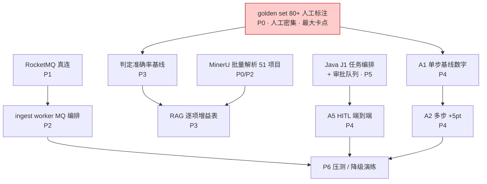

# 总体开发路线（RAG + Agent + Java 三线合并）v1.0

> **文档定位**：本文是施工层的**总进度计划**。仓库里原有四份路线文档分工不同——02 §九 回答"每周大致做什么"（12 周总览）、03 §九 回答 RAG 实现顺序、10 + `agent/` 回答 Agent 每阶段怎么写、01 §五 是最早的 8 周计划 v1。本文把它们**合并成一张任务级计划**，并标注每项任务的实时状态。
> **本文回答三个问题**：今天该干什么？干完怎么算完（硬验收）？谁挡谁（关键路径）？
> **上游文档**：01（契约）/ 02（架构与选型权威）/ 03（RAG 组件级）/ 04（模型服务）/ 06（数据）/ 10 + agent（Agent 阶段）。
> **状态图例**：✅ 已完成 ｜ 🟡 部分完成/进行中 ｜ 🔲 未开始。状态基准日 2026-10-27。

---

## 一、一页总览：三线合并阶段表

| 阶段 | 周 | RAG 线 | Agent 线 | Java 线 | 里程碑（硬验收） | 状态 |
| --- | --- | --- | --- | --- | --- | --- |
| **P0** 数据与评估集 | W1–2 | 招标文件入库、MinerU 批量解析、golden set 标注 | — | — | 评测脚本自动输出判定准确率基线 | 🔴 全项目最大卡点 |
| **P1** 环境就绪 | W1–2（并行） | — | — | — | `check_env.py` 全绿 + RocketMQ 真连 + MinIO 起来 | 🟡 PG/Redis/Ollama 已就绪 |
| **P2** RAG 基础 | W3–4 | 父子块分块、双路+RRF+rerank、幂等对账、权限前置 | A0 契约冻结 | — | Hit@5 ≥ 0.75；重复入库零副作用；跨项目检索返回空 | 🟡 在线链路已实测通过 |
| **P3** 评测与调优 | W5–6 | 单变量实验、逐项增益表、拒答与引用校验 | A1 基线 → A2 主循环 | — | Faithfulness ≥ 0.85；难例准确率 +5pt | 🔲 待 golden set |
| **P4** Agent 化 | W3–11 穿插 | 三级缓存 | A3–A8 全阶段 | J0–J1（W8 起） | 80 项并发 6–8 分钟；`terminated_by` 可查；NOT_FOUND 精确率 ≥ 0.9 | 🟡 A0–A8 代码主体已落地 |
| **P5** Java 平台层 | W8–11 | — | A5 等 Java 审批队列 | J2 权限 / J3 审计 / J4 成文 / J5 成本 | 双项目并发数据隔离；断点续跑演示 | 🔲 空目录，无设计文档 |
| **P6** 生产化 | W12 | — | A8 收口 + Langfuse | 压测配合 | MQ 积压压测；LLM 故障不丢任务 | 🔲 |
| **P7** 作品化 | W12 | — | — | — | 3 篇博客 + 面试 5 个高频问题能脱稿答完 | 🔲 |

> 与原 12 周路线（02 §九）的关系：周编号沿用原计划，**实际进度已走到 W4 中段**——设计（P0 前）、环境（P1 主体）、RAG 在线链路（P2 主体）、Agent A0–A8 代码（P4 主体）均已完成或基本完成。剩余路线见第四节「现实排期」。

---

## 二、逐阶段任务单

### P0 · 数据与评估集（原 W1–2）

> 这是全项目**唯一的人工密集阶段**，也是立项门槛——01 文档原话："这一步过不了，项目不要继续"。

| # | 任务 | 状态 | 说明 |
| --- | --- | --- | --- |
| 0.1 | 从政采网/公共资源交易中心下载 10–15 套技术服务类招标文件 | ✅ | `data/raw/tenders/` 已入库 52 个项目（59 目录），超出目标 |
| 0.2 | MinerU 批量解析（扫描件→VLM 模式，文本型/复杂中文→pipeline 模式） | 🟡 | 仅 1/52 已解析（315 块）；其余 51 个待跑。解析路由与示例 handler 已在 `rag/offline/parsers/__init__.py` |
| 0.3 | 评分项抽取（链路 A：全文分章 → LLM 结构化抽取 → Pydantic 校验 → `scoring_items` 表） | 🔲 | 骨架 `rag/offline/scoring_extract.py` 已有，业务实现待补 |
| 0.4 | **golden set 80–120 项人工标注**（应答位置 + 判定 + 依据页码） | 🔲 | `eval/golden_set.jsonl` 不存在。**阻塞 P3/P4 全部数字** |
| 0.5 | 评测脚本自动化（一条命令出基线） | ✅ | `agent/eval_runner.py` 已落地（A8 交付物），等数据 |

**验收**：`eval/golden_set.jsonl` ≥ 80 项；评测脚本自动输出"评分项覆盖率 + 判定准确率"两个数字。
**坑预警**：解析产物现按 `tender_{日期}.md` 命名，10 月多个日期有 2–15 个同日期项目，**命名键会互相覆盖**——落地时必须改用完整项目编号或维护 `data/parsed/manifest.json`（`scripts/check_parse_sync.py` 已提供对账能力）。

### P1 · 环境就绪（原 W1–2 并行）

| # | 任务 | 状态 | 说明 |
| --- | --- | --- | --- |
| 1.1 | PG（pgvector + zhparser）/ Redis / Ollama 三模型 | ✅ | 容器运行中，175 测试通过 |
| 1.2 | RocketMQ 三进程本机启动（NameServer 9876 + Broker 10911 + Proxy 8081） | 🔲 | 手册 `docs/08` 已写（含 JDK21 坑）；客户端 `rocketmq/client.py` + 11 项测试已就绪，**真连未验证** |
| 1.3 | MinIO 容器启动 | 🔲 | 编排 `deploy/minio/` 就绪（凭证已统一为 minioadmin/minioadmin123），Docker Desktop 需手动起 |
| 1.4 | 真连联调（`scripts/e2e_rocketmq.py` 写 + 跑） | 🔲 | 发送/消费/ack/死信全路径 |

**验收**：`check_env.py` 全绿（零 WARN）；e2e 脚本证明消息进出 RocketMQ 与 MinIO 读写。

### P2 · RAG 基础（原 W3–4）

| # | 任务 | 状态 | 说明 |
| --- | --- | --- | --- |
| 2.1 | DDL + 七项 fail-fast 启动自检 | ✅ | `common/db.py`（含 pgvector codec 注册）+ `check_env.py` |
| 2.2 | 在线检索链路：双路并发召回 + RRF + Qwen3-Reranker（logprobs） | ✅ | 真实标书 315 块在库；`/retrieve` 三个真实查询实测通过（含"稠密路命中、稀疏路 0 命中"的双路价值实证）；延迟 0–15ms |
| 2.3 | 结构化分块：章节层级递归 + 父子块 | 🔲 | 当前 315 块来自 `docx_extract.py` 临时直切（706 小节），**生产分块待按 03 §4.3 实现** |
| 2.4 | MinerU 生产解析管线（接 0.2 产物重新嵌入入库） | 🔲 | 与 0.2 同一件事的两半 |
| 2.5 | 幂等入库 / 增量 / 对账 / 蓝绿 | 🟡 | 对账脚本已有；`rag/offline/indexer` 幂等键（`embedding_ver`）设计与实现待对齐 03 §4.5 |
| 2.6 | 权限前置（acl 入库 + 检索层强制注入过滤条件） | 🔲 | 03 §5.2 已设计；等 Java J2 给出权限模型后联调 |

**验收**：Hit@5 ≥ 0.75；同一文档重复入库零副作用；跨项目检索返回空（越权测试进 CI）。

### P3 · 评测与调优（原 W5–6）

| # | 任务 | 状态 | 说明 |
| --- | --- | --- | --- |
| 3.1 | 分层指标：Hit@5 / Recall@20 / 判定准确率 / 混淆矩阵 | 🔲 |  runner 已就绪，缺 golden set |
| 3.2 | 单变量实验：每加一个组件跑一次全量，出**逐项增益表** | 🔲 | 顺序铁律：无增益就回滚（03 §九） |
| 3.3 | Faithfulness 与引用校验（证据强制回查原文） | 🔲 | 护栏代码已在 `guardrails.py`，缺标注数据驱动 |
| 3.4 | 拒答阈值标定（按 category 分桶） | 🔲 | 需 3.2 的真实分布数据 |

**验收**：Faithfulness ≥ 0.85；每一项优化的增益单独可测、有数据。

### P4 · Agent 化（A0–A8，34 工作日，穿插 W3–11）

> 逐阶段伪代码指引以 `docs/agent/` 和 `10-Agent开发路线与阶段开发指引.md` 为准，此处只记状态与差异。

| 阶段 | 状态 | 备注 |
| --- | --- | --- |
| A0 契约与骨架 | ✅ | `contracts/{state,verdict,decision}.py` + `fake_llm.py` |
| A1 单步基线 | 🟡 | 代码在（`query.py`）；**基线数字等 golden set** |
| A2 主循环 | ✅ | `loop.py` + `dispatch.py`；云端 LLM 真跑 2 例：S-ops-1 两步收敛 PASS 0.95→auto；S-staff-1 三步 PARTIAL 0.75→review（缺口分析准确） |
| A3 工具层四件套 | ✅ | `tools/registry.py`（search / get_section / check_doc / compare） |
| A4 checkpointer | 🟡 | `state.py` 已落地；`kill -9` 恢复实测（重烧 token < 5%）未做 |
| A5 interrupt + HITL | 🟡 | `interrupt.py` + api 回调已在；**等 Java J1 审批队列**才能端到端 |
| A6 护栏与置信度 | 🟡 | `guardrails.py` + `confidence.py`（缺信号归一化已修）；阈值标定等 3.2 |
| A7 并发与缓存 | ✅ | `scheduler.py`（信号量 + contextvars 归属）+ `cache.py` 三级缓存 |
| A8 观测与评测 | 🟡 | `telemetry.py` 三 span + `eval_runner.py`；**Langfuse exporter 未接**（当前仅 OTLP 管道） |

**验收**：难例（跨章节/附件/负偏离）准确率比 A1 提升 ≥ 5pt；80 项从 40 分钟压到 6–8 分钟；每次改动自动出"涨了还是跌了"报告。

### P5 · Java 平台层（原 W8–11）——本项目最大的内容缺口

> `review-platform/` 目前是**空目录，且无任何设计文档**。01 §Phase4 和 02 §二 L2 层只有模块名单，没有契约定稿。本节把 J0–J5 的任务单列出来，**动工前应先补一份 Java 平台层设计文档**（本文只给任务单，不代替设计）。

| 模块 | 任务 | 验收 |
| --- | --- | --- |
| **J0 骨架与契约** | Spring Boot 3.5 + Java 21 骨架；双栈契约定稿（Verdict JSON ↔ Jackson，字段冻结自 01 §三）；Engine HTTP 客户端（同步追问链路）；trace_id 从 Java 网关生成并全链路透传 | 契约文档评审通过；Python 侧 JSON 能被 Java 无损解析 |
| **J1 任务编排** | 任务状态机 `PENDING→PARSING→EXTRACTING→REVIEWING→DONE/FAILED`；提交即返回 taskId（幂等）；SSE 进度推送（Java 21 虚拟线程扛长连接）；取消/重试；RocketMQ 生产端（topic `bid-review`）；断点续传（指挥 engine 从 `agent_state` 恢复，不重烧 token） | 提交即返回；kill 进程后任务不丢、恢复后续跑 |
| **J2 权限与数据隔离** | RBAC + 行级（用户→项目→标段→文档）；**权限作为检索过滤条件透传给 engine**（检索前过滤，业务代码无法绕过——这是 RAG 权限设计核心难点，绝大多数 demo 的死穴） | 两个项目并发跑，数据互不可见；越权检索返回空 |
| **J3 审计与 HITL** | `audit_log(task_id, actor, action, model_version, evidence_ids, before, after, reason, ts)`；人工复核界面（证据链展示：页码/章节/原文/bbox）；审批队列；完成后回调 engine（驱动 A5 恢复） | 评标被质疑时能自证；挂起 2 小时恢复结论一致 |
| **J4 文档服务与成文** | 上传（MinIO + 版本管理）；Apache POI 技术偏离表（评分项/判定/依据页码/备注，合并单元格大表格保真） | 偏离表样式规范，可直接进评标档案 |
| **J5 成本与限流** | Token 配额按项目核算；超限排队；429 背压；成本看板（每评分项平均 token 与耗时） | 超配额项目自动降级不拖垮全局 |

**验收**（合并 01/02 口径）：并发双项目数据隔离测试通过；断点续跑演示成功；审计链路完整。

### P6 · 生产化（原 W12）

| # | 任务 | 状态 |
| --- | --- | --- |
| 6.1 | Langfuse trace 接入（telemetry 已埋 span，补 exporter） | 🔲 |
| 6.2 | Prometheus 告警 + 日志归集 | 🔲 |
| 6.3 | MQ 积压压测（按积压扩容的信号验证） | 🔲 |
| 6.4 | 降级演练：LLM 故障 → NOT_FOUND + 强制人工，任务不丢 | 🔲 |

### P7 · 作品化（原 W12）

3 篇博客（逐项增益数据 / 检索层权限过滤 / 双栈边界）+ README 架构图与评估表 + 简历表述对齐（01 §七）。验收：面试 5 个高频问题能脱稿答完。

---

## 三、关键路径与阻塞图

**三条必须记住的阻塞关系**：

1. **golden set 阻塞一切数字**。基线、增益表、阈值标定、回归全等它。它是人工活，越晚开始越晚完工——建议本周就启动标注，先标 40 项跑通流程，再补到 120。
2. **Java J1 阻塞 A5 端到端**。interrupt 代码已写好，但没有审批队列就没有端到端 HITL 演示。J1 要排在 Java 线最前面。
3. **RocketMQ 真连阻塞 ingest 编排与压测**。客户端已写好且 11 项测试通过，只差三进程起来跑一次真连——这是性价比最高的一项（半小时 vs 卡住后面两周）。

---

## 四、剩余工作现实排期（自 2026-10-27 起）

> 12 周原计划已走完约 W4 中段。以下按"还剩什么"重排，周编号为**相对周**。

| 相对周 | RAG 线 | Agent 线 | Java 线 | 周末里程碑 |
| --- | --- | --- | --- | --- |
| W+1 | 启动 MinerU 批量解析（断点续跑 + 对账）；golden set 标注开工（先 40 项） | A4 kill -9 恢复实测 | J0 骨架 + 契约定稿 | **M1：golden set 40 项 + 契约评审过** |
| W+2 | 解析收尾 + 生产分块 + 重新入库 | A1 出基线数字（40 项版） | J1 任务编排（状态机/SSE/生产端） | **M2：基线数字 + Java 提交即返回** |
| W+3 | 单变量实验（分块/双路/rerank 逐项） | A2 全量回归 | J2 权限透传 + 越权测试 | **M3：逐项增益表 + 数据隔离测试过** |
| W+4 | 幂等/对账收尾；三级缓存联调 | A6 阈值标定 + 难例集 | J3 审计 + HITL 界面 | **M4：HITL 挂起/恢复演示** |
| W+5 | — | A5 端到端 + A7 压测（80 项） | J4 POI 偏离表 | **M5：偏离表成品 + 80 项 6–8 分钟** |
| W+6 | 权限前置联调收尾 | A8 Langfuse 接入 + 回归闭环 | J5 成本限流 + 压测配合 | **M6：降级演练 + 压测报告** |
| W+7 | — | — | — | **M7：3 篇博客 + 作品化收口** |

> 若 golden set 标注延迟，W+1/W+2 的 Agent 数字顺延——**不要用假数据出数字**，基线造假比没有基线更糟（后面所有"提升"都不可信）。

---

## 五、三线并行策略

1. **RAG 与 Agent 从 Day 1 就可并行**：A0 契约冻结不依赖检索；A1 之后每阶段都吃检索质量，所以 RAG 的增益实验（P3）要赶在 Agent 全量回归之前出数据。
2. **Agent 与 Java 从 W+1 起并行**：A4 不依赖 Java；A5 卡 J1 的审批队列——所以 J1 必须最先做，且接口（回调协议）在 J0 就定稿。
3. **人工与开发并行**：golden set 标注（人工）与 MinerU 批量解析（机器长任务）都放在早期，两者都不阻塞开发，只阻塞"出数字"。
4. **Java 线内部顺序**：J0 → J1 →（J2/J3 可并行）→ J4/J5。J2 的权限模型要反过来驱动 RAG 2.6，所以 J2 接口要在 W+3 前给到。

---

## 六、风险与对策

| 风险 | 影响 | 对策 |
| --- | --- | --- |
| golden set 标注工作量被低估 | 全线数字延迟 | 先 40 项跑通流程；标注规范写进 `eval/README`；难例专项集单独标 |
| 51 个项目 MinerU 解析耗时/失败 | RAG 覆盖率不足 | 断点续跑 + `check_parse_sync.py` 对账；失败项进重试队列，不阻塞已解析部分 |
| 解析产物命名键冲突（同日期多项目） | 数据互相覆盖、静默错误 | 改用完整项目编号或 `manifest.json`；对账脚本加命名校验 |
| Java 层从零起步工期爆炸 | P5 拖垮 P6 | J4/J5 可裁剪（偏离表先出简版）；J1–J3 体现企业级能力，不能砍 |
| LLM 成本失控 | 预算烧穿 | A6 预算护栏 + A7 缓存；成本看板（J5）每周看一次 |
| 本地重排 CPU 瓶颈（80 项并发） | 压测不达标 | 候选降 12（03 §5.4 开关）；或重排走云 API 降级链 |

---

## 七、进度仪表盘（2026-10-27）

| 子系统 | 已完成 | 进行中 | 未开始 |
| --- | --- | --- | --- |
| **数据（P0）** | 52 项目下载入库、对账脚本 | 1/52 解析 | golden set、评分项抽取、批量解析 |
| **环境（P1）** | PG/Redis/Ollama、175 测试 | — | RocketMQ 真连、MinIO 启动 |
| **RAG（P2/P3）** | 在线检索链路实测（315 块）、DDL 与自检 | 幂等对账 | 生产分块、批量入库、权限前置、全部评测 |
| **Agent（P4）** | A0–A3、A7 代码；云端真跑 2 例 | A1 数字、A4 实测、A5、A6 标定、A8 exporter | 难例集、全量回归、Langfuse |
| **Java（P5）** | — | — | 全部（空目录） |
| **生产化（P6/P7）** | OTLP 埋点管道 | — | Langfuse、告警、压测、降级演练、作品化 |

---

*维护约定：每完成一个任务单，更新对应状态列；每周末对照第四节里程碑打勾。状态过期比没有状态更糟。*
