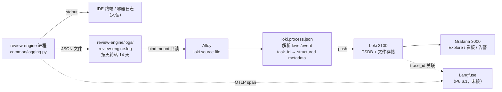

# 12 · 日志与可观测栈部署

上一份：[11 总体开发路线](11-总体开发路线（RAG+Agent+Java）.md) · 对应 11 §P6「生产化」

> **当前状态（2026-10-27，实测通过）**：`src/common/logging.py` 已落地（structlog + stdlib 桥接 + 队列异步落盘 + 脱敏）；`deploy/observability/` 已建并**本机起栈验证通过**——Loki 3.7.8 与 Grafana 13.2.2 跑容器，Alloy **v1.21.2 跑 Windows 二进制**（原因见 §启动：Windows 下采集器与被采进程同机才可靠）。**未做**：Langfuse 与 Loki 的 trace 双向跳转（需 OTLP exporter，见 11 §P6 6.1）、日志告警规则（Grafana Alerting 需先接 Prometheus/Alertmanager）。

## 这个阶段解决什么

日志不是"多打几行 print"。生产上它要同时回答三个问题：

1. **出错时能不能还原现场**——一条 error 日志必须能顺着 `trace_id` 找到那次判定的完整轨迹（哪一步、哪个工具、花了多少 token）。
2. **成本可不可控**——标书正文动辄几十万字，把原文写进日志，单任务日志量能从 700KB 涨到 20MB，磁盘和检索成本一起失控。
3. **机器能不能读**——`log.info(f"item {id} judged {v}")` 在 Loki 里只能全文扫；结构化字段才能 `count by (event)`、才能做告警。

这三条决定了下面所有设计：结构化输出、字段契约、脱敏截断、label 基数纪律。

## 交付物

```
review-engine/
├── .env                          # LOG_LEVEL / LOG_FORMAT / LOG_FILE_ENABLED / LOG_DIR ...
└── src/common/logging.py         # 唯一日志入口：setup / get_logger / bind_run_context
deploy/observability/
├── docker-compose.yaml           # loki + grafana（默认）+ alloy（--profile alloy）
├── .env / .env.example           # Grafana 管理员账号（凭证不进 compose 文件）
├── loki/loki-config.yaml         # 单机 TSDB + 文件存储 + 14 天保留
├── alloy/config.alloy            # 采集 → 解析 → label/structured metadata → 推 Loki
├── alloy/run-windows.ps1         # 本机（Windows）跑 Alloy 的启动脚本（与容器共用一份配置）
└── grafana/provisioning/
    └── datasources/loki.yaml     # 数据源自动装配（声明式，可复现）
```

## 配置到底该放哪：四层分工

新增日志配置时最常见的错误是"随手塞进最近的那个 yaml"。本项目按**变更节奏**分层，放错层会导致一次小改动触发一轮重标定：

| 层 | 文件 | 管什么 | 谁能改、多久改一次 |
| --- | --- | --- | --- |
| 进程运行参数 | `review-engine/.env` | 日志级别、stdout 格式、是否落盘、轮转天数、截断阈值 | 运维/开发，随时 |
| **业务阈值** | `review-engine/src/config/rag.yaml` | 分块、嵌入、召回、重排、缓存参数（21 项） | 发版，且要走 R7 标定 |
| 业务中间件编排 | `deploy/docker-compose.yaml` | PG / Redis | 几乎不动 |
| **可观测栈** | `deploy/observability/` | Loki / Alloy / Grafana 编排与采集规则 | 运维，独立启停 |

> 【坑】**采集器配置绝不能写进 `rag.yaml`。** 那份文件被 R0 的完成标准钉死为"检索阈值唯一来源"（`docs/rag/R0` §完成标准：`grep -n "0.15\|512\|6000" src/` 只剩配置读取）。把 `scrape_configs` 塞进去，一是语义错位（它由 RAG 代码读、由标定流程改），二是会让那条完成标准失效。

> 【why 独立编排】沿用项目既有模式（主 compose 注释里对 RocketMQ / MinIO 的处理一致）：可观测栈要能整体启停——排查"日志没进来"时第一件事就是停掉采集器单独重启，不该牵连业务中间件。主 `deploy/docker-compose.yaml` 只留一行注释指向本目录。

## 链路



两条输出是**故意分开**的：stdout 给人看（dev 用 console 彩色），文件恒为 JSON（给采集器）。若 dev 也输出 console 格式，Alloy 的 `stage.json` 解析不出 `level`/`event`，Loki 里就只剩一堆无标签的文本行——这是"本地能查、线上查询瞎了"的典型成因。

## 日志字段契约

字段定义在 `logging.py` 的 processor 链里，**采集侧的 `alloy/config.alloy` 必须与之一致**。改字段名要同时改两处（否则 tag 静默消失，不报错）。

| 字段 | 来源 | 排查用途 | Loki label？ |
| --- | --- | --- | --- |
| `ts` | processor 生成，ISO-8601 + 时区偏移 | 与人眼对时、跨时区排查 | 否（Loki 用入库时间） |
| `level` | structlog `add_log_level` | 按级别过滤/告警 | ✅ |
| `logger` | `get_logger(name)` 的 name | 定位是哪个模块 | 否 |
| `event` | 调用点第一个参数 | 聚合统计（`count by (event)`） | ✅ |
| `service` / `env` / `version` | `.env` 的 SERVICE_NAME / APP_ENV / APP_VERSION | 多环境、多版本对比 | `service` `env` ✅ |
| `host` / `pid` | 进程启动时采集 | 定位是哪台机器、哪个进程 | 否 |
| `run_id` | `bind_run_context()` | 区分同一次进程运行 | 否 |
| `trace_id` / `span_id` | OTel 当前 span（未配 OTLP 时不写） | 跳到 Langfuse 看完整轨迹 | structured metadata |
| `task_id` / `item_id` / `step` | `common.context` 的 contextvars | 按评分项回溯整个评审 | structured metadata |
| `exception` | `log.exception(...)` | 完整栈 | 否 |

> 【why `trace_id` 不写假值】没有配 OTLP（OpenTelemetry 的上报协议，负责把 trace/span 发给 Langfuse、Jaeger 这类后端）时 `get_current_span()` 返回 INVALID span。此时写全 0 的 trace_id 会让"按 trace 搜索"永远返回一堆无法关联的噪音，所以宁可不写字段。

> 【坑】**label 只能放低基数枚举。** Loki 的每个 label 组合就是一条 stream。`task_id` 每个任务唯一，做成 label 等于"一任务一条流"，几十个任务后索引和内存就被打满。所以 `task_id`/`item_id`/`trace_id` 走 Loki 3.x 的 **structured metadata**：能用 `| task_id="t-1"` 过滤，但不进索引。这一点是 Promtail 时代做不到的（只能塞进日志行里全文匹配），也是升级到 Alloy 的实际收益之一。

## 启动（三形态，按场景选一种）

### 形态 A · 本机开发（本项目当前形态，已验证）

```bash
# 1. 业务侧产出日志：确认 review-engine/logs/review-engine.log 出现 JSON 行
cd review-engine
.venv/Scripts/python.exe -c "
import sys; sys.path.insert(0,'src')
from common import logsetup
logsetup.setup(); logsetup.bind_run_context(task_id='t-local', item_id='S3.2.4', step=1)
logsetup.get_logger('smoke').info('env.ready')"

# 2. 起 Loki + Grafana（Alloy 不在默认 profile 里，见下）
cd ../deploy/observability
cp -n .env.example .env          # 首次
docker compose up -d             # 只起 loki + grafana
docker compose ps

# 3. 起采集器（另开一个窗口，Ctrl+C 停止）
cd alloy && ./run-windows.ps1
```

> 【why 采集器跑二进制】Python 进程在宿主机，Windows 下把日志目录 bind mount 进容器后 inotify 事件会丢（见坑 6），表现为"写了日志但没采到"。同机采集最可靠，也是生产上的标准形态（agent 与被采进程同机）。`config.alloy` 用 `sys.env` 读 `LOG_PATH`/`LOKI_URL`，**容器与本机共用同一份配置**——两份配置必然漂移。

### 形态 B · 全容器（Linux / 生产）

```bash
cd deploy/observability
docker compose --profile alloy up -d     # 三个容器一起
```

Alloy 容器读 `LOG_PATH=/var/log/bid-review/review-engine.log`（由卷 `../../review-engine/logs` 挂入）。

### 形态 C · 业务也容器化（K8s / 镜像部署）

改用 `config.alloy` 末尾的 `discovery.docker` + `loki.source.docker` 段采容器 stdout；同时 `review-engine/.env` 设 `LOG_FILE_ENABLED=false`（stdout 已是采集源，再写文件是冗余）。

| 入口 | 地址 | 用途 |
| --- | --- | --- |
| Loki API | http://localhost:3100/ready | 存活探针 |
| Alloy UI | http://localhost:12345 | **"采集通不通"先看这里**：能看到组件的 target 与最近一次读取 |
| Grafana | http://localhost:3000 | Explore → Loki（数据源已自动装配） |

## 验证（三层，缺一层就不知道断在哪）

```bash
# ① 采集器是否活着 / 是否抓到目标
curl -s -o /dev/null -w '%{http_code}\n' http://127.0.0.1:12345/   # 期望 200
#    详细组件状态看浏览器：http://localhost:12345（比读日志快）

# ② Loki 是否收到（看有哪些 label 值）
curl -s http://localhost:3100/loki/api/v1/label/service/values
# 期望：{"status":"success","data":["review-engine"]}

curl -s http://localhost:3100/loki/api/v1/label/event/values
# 期望：["llm.call.failed","retrieve.degraded","review.item.failed","review.item.judged"]

# ③ 查一条真实日志（含 structured metadata 过滤）
curl -sG http://localhost:3100/loki/api/v1/query_range \
  --data-urlencode 'query={service="review-engine"} | task_id="t-verify-002"' \
  --data-urlencode 'limit=5'

# ④ 证明 task_id 没进索引（这是 label 与 structured metadata 的分界线）
curl -sG http://localhost:3100/loki/api/v1/series \
  --data-urlencode 'match[]={service="review-engine"}'
# 期望：返回的每个 stream 里都没有 task_id / item_id（但 query_range 结果里能看到它们）
```

**本机实测结果（2026-10-27）**

| 检查项 | 实测 |
| --- | --- |
| `/label/service/values` | `["review-engine"]` |
| `/label/event/values` | `["llm.call.failed","retrieve.degraded","review.item.failed","review.item.judged"]` |
| `/label/level/values` | `["error","info","warning"]` |
| `/series` 的 stream 标签 | `env / event / filename / job / level / service / service_name`（**无 task_id**） |
| `query_range` + `\| task_id="t-verify-002"` | 命中 3 条，stats 里 `totalStructuredMetadataBytesProcessed=144`（走的是 structured metadata 通道） |
| 脱敏 | 落库的 `api_key` 为 `***` |
| 时间戳 | `ts=2026-10-27T22:58:09.764+08:00`（带时区偏移） |
| Grafana 数据源 | `name=Loki type=loki url=http://loki:3100 isDefault=true`（provisioning 生效） |
| Grafana 代理查询 | 通过 `/api/datasources/proxy/uid/loki-default/...` 拿到同样的 event 值 |

> `/query_range` 的 `stream` 字段里能看到 `task_id`/`item_id`，别被误导成 label——Loki 3.x 会把命中的 structured metadata 内联展示。判定标准是 `/series`（索引里的流）里有没有它。

Grafana Explore 里的等价查询：

```logql
{service="review-engine"} | json                      # 展开全部字段
{level="error"}                                       # 只看错误（label 过滤，最快）
{service="review-engine"} | task_id="t-1" | event="review.item.judged"
{service="review-engine"} | trace_id="4bf92f..."      # 跳到 Langfuse 的桥
count by (event) (count_over_time({service="review-engine"}[5m]))   # 事件分布
```

**验收标准**：`/label/event/values` 里能看到 `event` 值（=label 生效）；`| task_id="..."` 能过滤出结果（=structured metadata 生效）；Grafana 里 `ts` 显示带 `+08:00`。

## 使用规范（写代码时照这个来）

**级别语义**

| 级别 | 用在哪 | 本项目示例 |
| --- | --- | --- |
| DEBUG | 检索中间量、缓存键、prompt 全文（默认关） | `retrieve.candidates`（dense/sparse 各多少） |
| INFO | 业务里程碑，一条消息一个事件 | `review.item.judged`、`mq.message.consumed` |
| WARNING | **降级但任务继续** | `retrieve.degraded`（no_rerank）、`cache.put_failed`、`llm.rate_limited` |
| ERROR | 单条失败、任务可继续 | `review.item.failed`、`mq.message.dead_lettered` |
| CRITICAL | 进程级不可恢复 | `startup.selfcheck_failed`、`db.pool_unavailable` |

**事件命名**：`领域.对象.动作`，snake_case。事件名是**聚合维度**，不是消息体——可变内容一律作字段。

```python
log = logsetup.get_logger(__name__)

# ✅
log.info("review.item.judged", task_id=task_id, item_id=item_id, step=state.step,
         verdict=v.verdict, confidence=round(v.confidence, 3), terminated_by=state.terminated_by)
log.warning("retrieve.degraded", mode="no_rerank", item_id=item_id, reason=err_type)
log.exception("llm.call.failed", model=model, step=step)      # 自动带 exception 字段

# ❌
print("judged", v)                          # ruff T20 拦
log.info(f"item {item_id} judged {v.verdict}")   # 不可聚合，维度爆炸
log.info("payload", body=full_bid_text)     # 标书原文进日志 = 合规事故（靠截断兜底，但不该靠）
log.error("failed")                         # 没栈没字段，等于没记
```

**与 OTel 的分工（别重复记）**：耗时、token、成本、召回数这些**数值事实走 span**（`agent/telemetry.py` 的 `agent.step` / `tool.call` / `llm.call`）；日志只记**离散事件与异常**。同一件事两边都记，会导致看板数字和日志对不上。

## 与 `rag.yaml` 无关，但与 `docs/11 §P6` 有关

- 本文只覆盖**日志**这一路信号。trace（Langfuse）与指标（Prometheus）之间的联动见 11 §P6 任务单。
- 告警先上三条（Grafana Alerting，基于 LogQL）：
  1. `count_over_time({level="error"}[5m])` 速率突增
  2. `{event="mq.message.dead_lettered"}` 出现即告警（对应 A3/worker 的死信路径）
  3. `{event="startup.selfcheck_failed"}` 出现即告警（对应 R0 的七项 fail-fast）

## 常见坑（全部实测踩过）

> 【坑 1】**Promtail 已不可用。** EOL 日期 2026-03-02；Loki 3.7.3（2026-06-24）起镜像内已移除该组件。网上抄来的 `scrape_configs` 版配置在新 Loki 上连进程都不存在。采集统一用 Alloy，且配置语言不同（components 块，不是 YAML）。

> 【坑 2】**`docker_sd_configs` 抓不到本项目的主进程。** Python/Java 跑宿主机（主 compose 开头写明），Docker socket 里只有 `bid-pg`/`bid-redis`。这种配置部署上去"看起来正常"，但业务日志一条都不进——排查时容易怀疑 Loki，其实源头就错了。开发期采文件（本配置），容器化后换 `discovery.docker` + `loki.source.docker`（`config.alloy` 末尾已备好整段）。

> 【坑 3】**`logging.handlers.QueueHandler` 会把 structlog 的 dict 消息拍平。** 它的 `prepare()` 会调 `getMessage()` 把 `record.msg` 变字符串，而 structlog 的 `wrap_for_formatter` 靠 `record.msg` 是 dict 来还原 event_dict。结果：日志全丢，stderr 刷 `'str' object has no attribute 'copy'`。修法见 `logging.py` 的 `_DictQueueHandler`（覆盖 `prepare` 原样返回）。

> 【坑 4】**`.env` 不会自动进 `os.environ`。** `logging.py` 刻意不依赖 `common.config`（要能在配置类崩塌时工作），所以它自己读环境变量——但如果没人把 `.env` 灌进 environ，`LOG_LEVEL`/`LOG_FORMAT` 全是摆设，实际生效的永远是默认值。所以 `setup()` 第一件事是 `load_dotenv(..., override=False)`（显式环境变量优先，容器注入不被文件覆盖）。

> 【坑 5】**dev 用 console 格式 = Loki 解析不出标签。** 因此文件 handler 恒为 JSON、stdout 才按 `LOG_FORMAT`。改 `logging.py` 时不要图省事让两者共用一个 formatter。

> 【坑 6】**Windows 上 bind mount 的 inotify 事件会丢**，表现为"日志写了但 Alloy 没反应"。两种解法：改用容器化部署（`loki.source.docker`），或在 Windows 直接跑 `alloy.exe` 采本地文件（agent 与被采进程同机，本就是标准形态）。不要跟 bind mount 较劲。

> 【坑 7】**retention 配了不删盘。** `limits_config.retention_period` 只是"声明"，真正删数据靠 `compactor.retention_enabled: true` + `delete_request_store`。少一个，磁盘只会一直涨。

> 【坑 8】**Loki 容器写不进 Windows bind mount。** 镜像默认 uid 10001，Docker Desktop 的挂载权限又宽松，表现为启动即退出并报 permission denied。本 compose 用 `user: "0:0"` 跑开发环境；Linux 生产部署要去掉这一行并 `chown -R 10001:10001 data/loki`。

> 【坑 9】**Alloy 的镜像 tag 带 `v` 前缀。** 是 `grafana/alloy:v1.21.2`，不是 `1.21.2`（Loki 与 Grafana 反而没有 `v`：`3.7.8` / `13.2.2`）。写错时 Docker Hub 报 `denied` 而不是 `manifest unknown`，很容易误判成"没权限"而反复翻配置。查真实 tag 以 GitHub Releases 为准（docker manifest inspect 在部分环境不可用）。

## 完成标准

- [x] `logs/review-engine.log` 每行是合法 JSON（`json.loads` 通过）
- [x] `api_key` 等敏感字段落盘为 `***`（脱敏 processor 生效）
- [x] `ts` 带时区偏移，`task_id`/`item_id`/`step` 由 contextvars 自动带出（业务代码不手写）
- [x] `loki -config.file=... -verify-config` 输出 `config is valid`
- [x] 起栈后 `{service="review-engine"}` 有流，`level`/`event` 为 label
- [x] `| task_id="..."` 能过滤，且 `/series` 里不含 `task_id`（=structured metadata 生效、未进索引）
- [x] Grafana 数据源由 provisioning 自动装配，可代理查询 Loki
- [ ] 容器重启后不重复推送旧日志（positions 持久化在 `alloydata` 卷）——开发期用二进制形态，该卷未启用，待形态 B 验证
- [ ] Langfuse 双向跳转（P6 6.1）
- [ ] 三条日志告警上线（需 Alertmanager）

## 本阶段术语

> 【白话】**structured metadata**：Loki 3.x 的"轻量标签"。能像 label 一样过滤，但不进索引、不切分流，专门装 `task_id` 这类高基数值。
> 【白话】**stream（流）**：一组 label 完全相同的日志序列。label 组合越多，流越多，Loki 越吃内存。
> 【白话】**positions**：采集器"每个文件读到第几行"的记账本。丢了就会重头读（重复）或跳过（漏读）。
> 【白话】**ProcessorFormatter**：structlog 与标准库 logging 之间的桥。作用是让 uvicorn/asyncpg 这类第三方库的日志也按同一套字段输出。

回到 [docs/README.md 文档地图](README.md) · 相关：[02 §五 观测流](02-系统总体架构与技术选型.md) · [agent/A8 观测与评测](agent/A8-观测与评测.md) · [11 §P6 生产化](11-总体开发路线（RAG+Agent+Java）.md)
