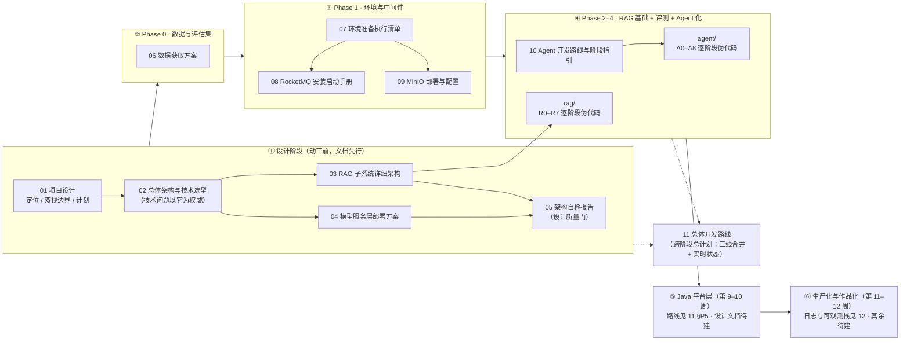

# 文档地图（docs/ 总入口）

> **本文件回答三个问题**：这个仓库有哪些文档？每份文档在开发流程的哪个位置用？第一次读应该按什么顺序读？
> **编号规则**：`01–10` 按开发流程排序——先设计、再数据、再环境、最后开发；`11` 是跨阶段总计划（见清单表注），`12` 起为生产化阶段（同样见清单表注）。新增文档必须延续编号并登记到下表（见第五节）。

---

## 一、开发流程与文档对应关系



> 阶段划分以 `02-系统总体架构与技术选型.md` §九「12 周实施路线」为准；`01` 中的 8 周计划是早期 v1 版本，口径以 02 为准。

---

## 二、文档清单

| # | 文档 | 所属阶段 | 回答什么问题 | 状态（2026-10-27） |
| --- | --- | --- | --- | --- |
| 01 | [项目设计与Java经验嵌入方案](01-项目设计与Java经验嵌入方案.md) | ① 设计 | 项目定位、Python/Java 双栈边界、置信度契约、8 周计划 v1 | 定稿 v1 |
| 02 | [系统总体架构与技术选型](02-系统总体架构与技术选型.md) | ① 设计 | 分层架构、五数据流、全栈选型、并发设计、12 周路线 v2——**技术争议的最终权威** | 定稿 v1.0 |
| 03 | [RAG子系统详细架构](03-RAG子系统详细架构.md) | ① 设计 | 离线管道 + 在线检索链路的组件级设计：DDL、索引、契约、阈值 | 定稿（2026-10-26 统一 MinerU 解析） |
| 04 | [模型服务层部署方案](04-模型服务层部署方案.md) | ① 设计 | 嵌入/重排本地化（Ollama + logprobs）、Provider 抽象、降级链 | 定版 2026-10-22 |
| 05 | [架构自检报告](05-架构自检报告.md) | ① 设计 | 四份设计文档的一致性核查结论（修了 1 处真实 SQL bug） | v1（2026-10-21，设计已冻结） |
| 06 | [数据获取方案](06-数据获取方案.md) | ② Phase 0 | 招标文件从哪里来、golden set 怎么建、两类文档可得性现实 | 定稿；`data/raw` 已入库 52 个项目 |
| 07 | [环境准备执行清单](07-环境准备执行清单.md) | ③ Phase 1 | 从零到「依赖装好 + 中间件健康 + 自检全绿」的逐步操作 | 已执行（PG/Redis/Ollama 运行中） |
| 08 | [RocketMQ本机安装与启动手册](08-RocketMQ本机安装与启动手册.md) | ③ Phase 1 | 三进程（NameServer/Broker/Proxy）本机启动，含 JDK21 等 6 个实测坑 | 手册已写；三进程未启动、真连未验证 |
| 09 | [MinIO部署与配置](09-MinIO部署与配置.md) | ③ Phase 1 | Docker Compose 单节点 MinIO，账号/端口/数据卷 | 文档已写；容器未启动 |
| 10 | [Agent开发路线与阶段开发指引](10-Agent开发路线与阶段开发指引.md) | ④ Phase 2–4 | Agent 层开发顺序、每阶段验收指标、术语总表、排期对齐 | v1.0；A0–A8 主体已落地 |
| — | [agent/](agent/) | ④ Phase 2–4 | A0–A8 逐阶段**伪代码级**指引（每行代码的含义、原理、坑） | A0–A8 共 9 份，与 10 配套 |
| — | [rag/](rag/) | ②④ Phase 0–3 | R0–R7 逐阶段**伪代码级**指引（契约/解析/分块/入库/召回/重排/缓存/评测） | R0–R7 共 8 份，与 03 配套 |
| 11 | [总体开发路线（RAG+Agent+Java）](11-总体开发路线（RAG+Agent+Java）.md) | **跨阶段 · 总计划** | 三线合并的任务级进度计划：每任务状态、硬验收、关键路径、剩余排期——**"今天该干什么"看这篇** | v1.0（2026-10-27，含实时进度仪表盘） |
| 12 | [日志与可观测栈部署](12-日志与可观测栈部署.md) | ⑥ 生产化 | 日志字段契约、四层配置分工、Loki+Alloy+Grafana 起栈与验证、9 个实测坑 | v1.0（2026-10-27，本机起栈验证通过） |
| 13 | [解析链路代码审查清单](13-解析链路代码审查清单.md) | ④ Phase 2 · RAG 解析 | `parsers/` 四个模块的逐行审查结论：20 条问题的位置、影响、修法、修复状态 | 2026-11-05，parsers 修完；整条链路仍卡 5 个 P0 |
| 14 | [RAG线开发计划（真实代码基线）](14-RAG线开发计划（真实代码基线）.md) | ④ Phase 2–3 · RAG 线施工 | RAG 线任务级施工计划：以 2026-11-05 磁盘代码盘点为基线，六个批次任务单（每批以测试转绿为出口判据）、并行任务、验证命令——"RAG 今天该干什么"看这篇 | v1.0（2026-11-05；R0–R7 头部旧状态行以此为准） |

> 11 是唯一一份跨阶段文档：它不新增设计内容，而是把 02 §九 / 03 §九 / 10 §二 / 01 §五 四张路线表合并成一张可执行的任务单，因此编号排在开发阶段之后。
> 12 是生产化阶段的第一份：它把"日志怎么打、放哪配置、怎么采、怎么查"定成契约，对应 11 §P6 任务单。

---

## 三、三条阅读路径

**路径 A · 第一次读这个仓库（建立全局观，约 40 分钟）**
根 `README.md` → 本文件 → `01`（定位与边界）→ `02` §一~§五（架构与选型，§九 看排期）→ 按需深入 03/04。

**路径 B · 准备动手开发（按流程走，不跳步）**
`11` 总体开发路线（看当前阶段与今天该干什么）→ `07` 环境准备（不过不进下一阶段）→ `08`/`09` 按需起中间件 → `10` §二 路线总览 / `03` §九 实现顺序 → `rag/` 或 `agent/` 当前阶段的文档 → 写代码。

**路径 C · 查手册（遇到具体问题再来）**
RocketMQ 起不来 → `08`；MinIO/对象存储 → `09`；日志不流动 / 查不到、Loki 标签为空 → `12`；检索参数/阈值 → `03`；模型服务/logprobs → `04`；术语看不懂 → `10` §一 术语总表。

---

## 四、文档间依赖（改一份文档时，知道要连带检查谁）

```
01（契约与计划）
 └─→ 02（总体架构，技术权威）
      ├─→ 03（RAG 组件级） ─┬─→ rag/R0–R7（逐阶段落地）
      │                    └─→ 05（自检：四份必须口径一致）
      ├─→ 04（模型服务层） ────→ 05
      └─→ 10（Agent 路线）──→ agent/A0–A8（逐阶段落地）
06（数据） ── 独立，Phase 0 前置
07（环境） ──→ 08 / 09（中间件手册）
11（总计划）── 汇总以上所有路线，被所有阶段文档回链；改任何路线文档都要同步 11 的任务单与状态
12（日志与可观测栈）── 依赖 02 §五 观测流；字段契约与 review-engine/src/common/logging.py、
                        deploy/observability/alloy/config.alloy 三方必须一致（改一处要同步三处）
```

**改文档时的连带规则**：改 02 的选型 → 必须同步检查 03、04、10 的对应章节（05 报告的 9 处不一致就是这么来的）；改 10 的阶段契约 → 检查 `agent/` 对应 A 阶段文档和 `review-engine/src/` 里的代码注释（代码注释大量引用 `docs/NN §X`，改编号会断链）。

---

## 五、编号与命名约定（新增文档必读）

1. 文件名格式：`NN-中文名称.md`，NN 为两位数字，**按开发流程顺序编，不按写作顺序编**。
2. 子目录用阶段号：`agent/` 用 `A0–A8`（与 10 的阶段表对应）。目录名与源码子系统同名——`agent/` ↔ `review-engine/src/agent/`，`rag/` ↔ `review-engine/src/rag/`——看到目录名就知道对应哪层代码。
3. 新文档写进本文第二节的清单表（编号、阶段、定位、状态四列必填）。
4. 文档内互相引用用相对路径或 `docs/NN §章节号`，**不要只写文档名不写编号**。
5. 每完成一个 Phase，更新第二节的「状态」列——状态过期比没有状态更糟。

---

## 六、当前进度快照（2026-10-27）

**已落地**

- 设计定稿 01–05，并通过一次选型一致性自检（05，修复 1 处真实 SQL bug）
- 开发环境：PG（pgvector + zhparser）/ Redis / Ollama 运行中，178 项测试全过
- RAG 检索链路：真实标书 315 块入库，`/retrieve` 实测可用（双路召回价值已验证）
- Agent：A0–A8 主体落地，云端 LLM 真实全链路验证通过（2–3 步收敛、证据精准）
- RocketMQ 自研 gRPC 客户端（11 项测试）；MinerU 统一解析方案已同步全部文档
- 日志与可观测栈：`src/common/logging.py`（结构化日志 + 脱敏 + 队列异步落盘）、`deploy/observability/`（Loki + Alloy + Grafana），本机起栈验证通过（`{service="review-engine"}` 有流，label 与 structured metadata 均生效）

**未完成（按流程顺序，含阻塞关系）**

| 事项 | 所属阶段 | 阻塞什么 |
| --- | --- | --- |
| golden set 80+ 项人工标注 | Phase 0 | **一切评测与调优的数字基线**（立项门槛） |
| 51/52 个项目未做 MinerU 解析 | Phase 0 | 检索库覆盖率 |
| RocketMQ 三进程启动 + 真连验证 | Phase 1 | ingest/review worker 的 MQ 编排 |
| MinIO 容器启动 | Phase 1 | 对象存储读写路径 |
| ingest worker MQ 编排 | Phase 2 | 离线管道自动化 |
| Java 平台层（`review-platform/` 空目录） | Phase 5 | 任务编排/权限/审计/POI 偏离表，**且缺设计文档** |
| Langfuse exporter 接入（当前仅 OTLP 管道） | Phase 6 | 可观测性演示 |
